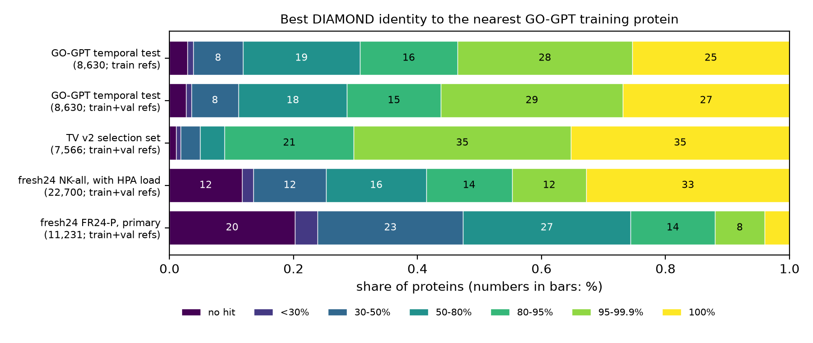
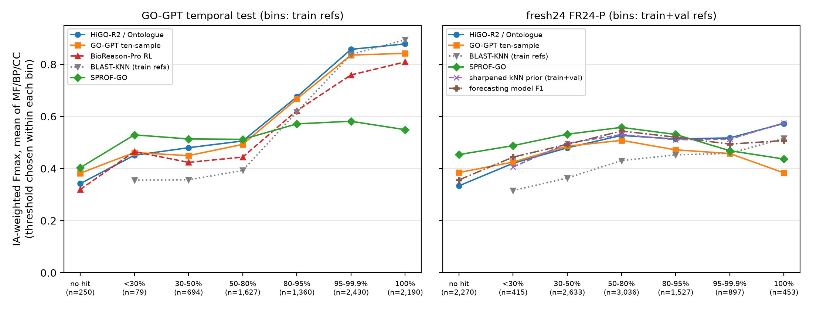
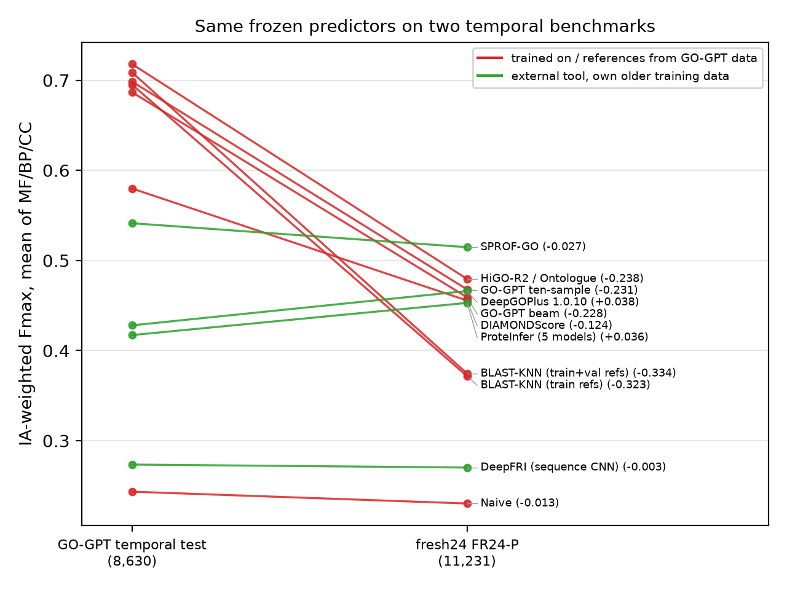

<!--
DRAFT, 2026-10-25. Every number in this file is copied from a tracked or logged result file of this repository.
The file is named in an HTML comment next to the number (src: ...) and again in the Sources appendix.
Figures are produced by docs/paper/make_figs.py from tracked tsv files only.
-->

# Temporal GO benchmarks reward homology transfer: a re-evaluation of GO-GPT and BioReason-Pro on fresh annotations

*Draft for a workshop / short paper. Authors and affiliations to be added.*

## Abstract

Protein function prediction is usually scored on temporal holdouts: proteins that gained experimental Gene
Ontology (GO) annotations after a training cutoff. We re-examine the temporal test set used for GO-GPT and
BioReason-Pro (8,630 proteins, annotations from March 2023 to February 2024) and score published methods,
retrieval baselines and our own pipeline under one scorer that reproduces the published numbers to within
0.002 on identical predictions. More than half of the test set (53.5%) has a GO-GPT training protein at 95%
identity or more, and 88% at 50% or more; 45.2% of the proteins are zebrafish, and in the 100% identity bin 90.9% of best
hits come from the same organism. On this set, zero-training label transfer is as strong as the generative
models: the paper's own best-hit rule scores 0.695 IA-weighted Fmax against 0.698 for the released GO-GPT
checkpoint (ten-sample decoding) and 0.649 for BioReason-Pro, whose score equals that of the GO-GPT predictions
in its prompt. An identity-sharpened k-nearest-neighbour (kNN) prior, selected on a temporal validation set,
scores 0.721. Model selection on GO-GPT's random validation split ranks retrieval settings against the test
ranking (Spearman −0.54), and every learned combiner fitted on it lost to, or at best tied with, plain kNN on the
test set. A validation set that mimics the test's identity and organism mix fixes the large retrieval choices but did not predict whether learned components help. On a new benchmark of
annotations added after February 2024, checked against an archived GOA release and disjoint from all GO-GPT
splits (fresh24; 11,231 proteins in the primary set), only 12% of proteins have a ≥95% identity relative.
Methods built on GO-GPT's data lose 0.12–0.33 Fmax, external tools change by −0.03 to +0.04, and SPROF-GO becomes
the best method (0.515). We document three leakage traps found along the way (released training labels that
contain the test set, re-dated GOA annotations, and bulk annotation loads) and give a checklist for benchmark
builders.

## 1. Introduction

Experimental GO annotation accumulates slowly, so a predictor is useful mainly for proteins that are not yet
annotated. The Critical Assessment of Functional Annotation (CAFA) therefore scores predictors prospectively: predictions
are frozen at time *t0* and evaluated on annotations that appear later [CAFA1; CAFA2; CAFA3]. Retrospective
benchmarks imitate this protocol by splitting a GOA snapshot at a date. The protocol controls *when* an
annotation was made, but not *how far* a test protein is from the training data. If the proteins that gain
annotations in the test window are mostly near-copies of annotated training proteins, the benchmark measures
label transfer between close homologues, whatever the model architecture.

We study this question on the temporal benchmark released with BioReason-Pro [BioReason-Pro], on which GO-GPT, an
autoregressive GO-term decoder on ESM2 embeddings, and BioReason-Pro, a reasoning model that receives GO-GPT's
predictions in its prompt, were evaluated. The work started as a model-building project: we built a pipeline
(HiGO-R2, served as "Ontologue") for this benchmark under a pre-registered protocol. In the process, most of
what we learned concerned the benchmark rather than the model. This paper reports those findings. The pipeline is
our own and is evaluated alongside the published methods; we state where it is the subject of a claim.

Our contributions are:

1. A composition analysis of the GO-GPT temporal test (identity to training, organism mix, same-organism
   best hits) and a one-scorer re-evaluation of 19 prediction files, including the released GO-GPT checkpoint, BioReason-Pro
   RL, retrieval baselines and five external predictors.
2. Evidence that the choice of validation split determines which retrieval settings and combiners are selected,
   with a record of every selection and test look made.
3. fresh24, a benchmark of annotations added after 2024-02-29, checked against an archived GOA release, on which
   the ranking of the same frozen predictors changes.
4. A list of leakage traps with their measured size, and a checklist for benchmark builders.

## 2. Related work

**CAFA and its metrics.** CAFA1 [CAFA1], CAFA2 [CAFA2] and CAFA3 [CAFA3] established the no-knowledge /
limited-knowledge split, protein-centric Fmax and the BLAST and naive baselines. The information-accretion (IA)
weighting of terms and the semantic distance S-min come from Clark and Radivojac [Clark2013]. CAFA-evaluator
(`cafaeval`) [CAFAeval] is the reference implementation used in CAFA-5; all scores here use it or an in-memory
copy that reproduces it.

**GO-GPT and BioReason-Pro.** BioReason-Pro [BioReason-Pro] describes GO-GPT and the BioReason-Pro reasoning
model, releases the temporal test set used here (training annotations up to November 2022, GO 2023-01-01,
CAFA-5 IA) and reports IA-weighted Fmax of 0.651 for GO-GPT greedy (all proteins) and 0.663 for BioReason-Pro RL
(no-knowledge subset).

**Sequence-based predictors and retrieval.** DeepGOPlus combines a CNN with DIAMOND-based label transfer
[DeepGOPlus]. ProteInfer trains CNNs on Swiss-Prot [ProteInfer]. DeepFRI predicts function from sequence and
structure [DeepFRI]. DeepGO-SE uses ESM2 embeddings with a semantic-entailment objective [DeepGO-SE]. SPROF-GO
pools ProtT5 embeddings and diffuses labels over a homology graph [SPROF-GO]. InterLabelGO+ combines a network
with DIAMOND kNN [InterLabelGO]. ProtBoost (CAFA-5 second place) is described in a preprint [ProtBoost]; no
predictions or weights are available, so it appears only with paper-reported numbers. Homology search uses
DIAMOND [DIAMOND]; HiGO-R2 uses ESM2 [ESM2].

**Temporal splits and data hygiene.** CAFA's design already separates no-knowledge from limited-knowledge
targets and freezes predictions before the annotation window [CAFA2; CAFA3]. Our contribution is not a new
protocol but measurements on one widely used retrospective benchmark, and a set of concrete failure cases.

## 3. Benchmarks and protocol

### 3.1 Benchmarks and selection sets

**GO-GPT temporal test (G-test).** 8,630 proteins with experimental annotations added between March 2023 and
February 2024; ground truth, GO 2023-01-01 and CAFA-5 IA from the BioReason-Pro release. S6 denotes the
8,159-protein no-knowledge subset used in the paper's BioReason-Pro tables.
<!-- src: README.md Results; runs/compare_paper/report.md Setup -->

**Selection sets.** GO-GPT's own validation split (G-val, 13,305 proteins) is a random 10% of its training
proteins. We built two temporal validation sets from GO-GPT training proteins by stripping labels dated after
T0 = 2021-11-30 (label cutoff 2022-11-30). TV v1 (1,154 proteins) uses dated GOA for ten reference proteomes and
contains no zebrafish. TV v2 (7,566 proteins) adds zebrafish and rat sources and a *duplicate-accession* stratum
(6,328 proteins): one accession per same-organism ≥80% identity cluster is held out with its full labels,
because the test's ≥95% identity bins consist largely of further accessions of already-annotated genes, which
no date rule can admit. The TV v2 criterion ("test-like") reweights proteins so that cells of organism group ×
identity bin × same-organism best hit carry the test's shares, computed from DIAMOND hits only (effective
n 959.9).
<!-- src: src/cafa6/temporal_val.py docstring; logs/tv_knn.log (tv1, tv2, tv2_DA counts); runs/knn_sharp/chosen_v2.json (weights.effective_n) -->

**fresh24.** Experimental GOA annotations (EXP, IDA, IPI, IMP, IGI, IEP, TAS, IC and the HTP codes; NOT
qualifiers and IPI to protein binding excluded) dated after 2024-02-29, for (protein, aspect) pairs with no prior
experimental knowledge. Prior knowledge is the union of rows in the archived GOA release 219 (2024-02-09) and
rows dated on or before the cutoff in the current file (2026-10-11). Candidates whose accession, secondary
accession or sequence (md5) matches any GO-GPT train/validation/test protein or TV v2 protein were removed
(4,496 by accession, 498 by identical sequence). The result has 24,141 proteins; the primary set FR24-P is the
11,231 no-knowledge proteins that are not part of the Human Protein Atlas (HPA) bulk load (Section 4.5).
Secondary sets are all no-knowledge proteins (NK-all, 22,700), limited-knowledge proteins (LK, 1,441), FR24-P
without two other bulk loads (9,176) and FR24-P against the current GO release.
<!-- src: data/fresh24/README.md (Construction 1-6, Counts); runs/fresh24_stats.md; runs/fresh24_looks.md registration 2026-10-19 18:40:00 -->

### 3.2 Scoring

All rows are scored with the CAFA protocol as used by the GO-GPT paper: `cafaeval` with true-path propagation
(prop=max), precision averaged over proteins with at least one prediction (norm=cafa), thresholds 0.01–0.99, one
threshold per aspect chosen on the evaluated set for every row, GO 2023-01-01 and CAFA-5 IA. The headline metric is
IA-weighted Fmax (Fw), averaged over MF, BP and CC. The in-memory scorer reproduces the `cafaeval` CLI to about
1e-10 on two prediction files. On identical predictions, it reproduces the paper: the GO-GPT predictions
shipped with the test set score 0.649 against 0.651 in the paper's Table S3 and 0.664 against 0.664 on S6, and
our BioReason-Pro RL run scores 0.663 on S6 against 0.663 in Table S8 (all three aspects within 0.002). Intervals
are paired protein bootstrap 95% CIs (1,000 replicates). Per-bin scores choose the threshold within each bin.
<!-- src: runs/knn_sharp/scorer_check.json; runs/compare_paper/report.md "Offset between our scorer and the paper's numbers" -->

### 3.3 Pre-registration and look budget

Every keep/drop rule was written to a log (`runs/test_looks.md`) before the first validation score it governs,
with a threshold (typically +0.005 test-like Fmax with a bootstrap CI excluding 0) and a simplicity order. The
G-test budget was four looks; three were used: flat kNN (look 1, 0.5961), a MeanFlow label-refiner pilot (look 2,
0.6544) and HiGO-R2 (look 3, 0.7178). All other G-test numbers in this paper were computed afterwards on frozen
files and are logged as descriptive scoring; nothing was chosen from them. fresh24 had its own budget of four looks:
look 1 scored all frozen methods at once, look 2 scored the forecasting model of Section 4.6 (registered before its
predictions existed), and look 3 is registered for a model that was still being trained when this draft was written.
<!-- src: runs/test_looks.md (06:02:26, 06:41:45, 22:48:05, 17:45:00, 18:47:10, 20:52:04, 01:02:45); runs/fresh24_looks.md -->

## 4. Results

### 4.1 The GO-GPT temporal test is dominated by close homologues of training proteins

Table 1 and Figure 1 compare the identity of each protein to its nearest GO-GPT training protein across the
benchmarks and selection sets. On G-test, 53.5% of proteins have a training relative at ≥95% identity and 7,607
(88%) at ≥50%; only 329 (3.8%) have no hit or a hit below 30%. The close relatives are mostly in the same organism:
the top-bitscore hit has the query's organism for 90.9% of the 100% bin and 87.8% of the 95–99.9% bin, against
52.6% at 80–95% and 13.4% at 50–80%. The organism mix is unusual: zebrafish 45.2%, rat 19.4%, human 19.1%,
mouse 3.2%. 760 test proteins also occur in the training data with annotations in other aspects.
<!-- src: runs/compare_paper/per_bin.tsv (n per bin); logs/tv_knn.log ("test" block: organism_group, same_org_best_hit_by_bin); research_notes/Novel GO model beyond BioReason Pro/red_team.md (organism mix); NOTES.md GO-GPT benchmark section (760) -->

The two selection sets that were available or easiest to build look different. G-val has 30.0% of proteins at
≥95% identity and 3.8% zebrafish. TV v1 has 22.7% at ≥95%, no zebrafish, and its close hits are cross-species
(same-organism best hit in the 95–99.9% bin: 13.3%, against 87.8% on the test). fresh24's primary set is the
opposite of G-test: 12.0% at ≥95%, 20.2% with no hit.

**Table 1. Composition by best DIAMOND identity to GO-GPT training proteins.** Shares of proteins.
"Same-org." is the share of best hits from the query's organism in the 100% bin (G-test, G-val, TV) or over all
proteins (fresh24, where per-bin values are not tabulated).

| set | n | refs | ≥95% | 50–95% | <50% or no hit | same-org. best hit | largest organism group |
|---|---|---|---|---|---|---|---|
| G-test | 8,630 | train | 0.535 | 0.346 | 0.119 | 0.909 (100% bin) | zebrafish 0.452 |
| G-test | 8,630 | train+val | 0.562 | 0.326 | 0.111 | 0.624 (all) | — |
| G-val (random) | 13,305 | train | 0.300 | 0.400 | 0.299 | 0.765 (100% bin) | other 0.608 (zebrafish 0.038) |
| TV v1 | 1,154 | train | 0.227 | 0.448 | 0.325 | 0.568 (100% bin) | other 0.450 (zebrafish 0) |
| TV v2 | 7,566 | train | 0.691 | 0.256 | 0.053 | 0.816 (100% bin) | other 0.333 (zebrafish 0.086) |
| fresh24 FR24-P | 11,231 | train+val | 0.120 | 0.406 | 0.474 | 0.124 (all) | mouse 0.140 |
| fresh24 NK-all | 22,700 | train+val | 0.448 | 0.299 | 0.253 | 0.504 (all) | human 0.516 |

<!-- src: logs/tv_knn.log (identity_bins, organism_group, same_org_best_hit_by_bin for test, val, tv1, tv2); runs/knn_trainval/stats_test_bins.tsv and stats.json (best_same_org_after 5,387 of 8,630); runs/fresh24_stats.md (nk excl. HPA-only and nk rows; same_org_best_hit 1,390 and 11,448); runs/fresh24/report.md organism table (mouse n=1,569, human n=11,712); docs/paper/figs/fig1_data.tsv -->

**Figure 1.** Identity composition of the GO-GPT temporal test, the TV v2 selection set and fresh24. Bars give
the share of proteins in each bin of best DIAMOND identity (`--more-sensitive`, e ≤ 1e-3) to GO-GPT training
proteins (top row) or training + validation proteins (other rows). Data: `runs/knn_trainval/stats_test_bins.tsv`,
`stats_tv_bins.tsv`, `runs/fresh24/per_bin.tsv`.

### 4.2 Zero-training label transfer ties or beats the generative models on this test

Table 2 lists the main rows on G-test under one scorer. Three observations follow.

First, the best-hit transfer rule described in the paper (best DIAMOND hit by identity, all its propagated terms,
score = identity/100), which the paper did not score with Fmax, reaches 0.695. That is between GO-GPT beam (0.687)
and GO-GPT ten-sample (0.698) from the released checkpoint, and above the GO-GPT predictions behind the paper
(0.649). With GO-GPT's validation proteins added as references it reaches 0.709. The identity-sharpened kNN prior
(weights bits × exp((pident − max pident)/5) over the top 50 hits, normalised per aspect, train + validation
references), selected on TV v2 without a test look of its own (but see Section 6 on how the TV rule was set),
scores 0.721 in a descriptive scoring after look 3.
No paired interval was computed for the kNN prior against GO-GPT; the paired comparisons that exist are for
HiGO-R2, which adds a learned head and stacker to this prior: +0.019 [+0.014, +0.025] over GO-GPT ten-sample and
+0.069 [+0.062, +0.076] over BioReason-Pro RL. On the test set the learned parts did not add to the prior
(0.7178 vs 0.7206), so the margin is a property of the retrieval prior. An earlier grid of sharpened kNN settings
scored directly on the test gave 0.685–0.701; the setting chosen on G-val scored 0.691, +0.005 [−0.002, +0.012]
against GO-GPT beam (300 replicates), i.e. a tie.
<!-- src: runs/compare_paper/summary.tsv; runs/compare_paper/report.md (Main observations 3-4); runs/eval_suite_v2/report.md Overview and section 1; runs/test_looks.md 2026-10-18 17:45:00; research_notes/Novel GO model beyond BioReason Pro/red_team.md §3.2 -->

Second, BioReason-Pro adds nothing measurable over its input. Its RL checkpoint, run with the authors' evaluation
script and published settings, scores 0.649 on all proteins and 0.663 on S6, the same as the GO-GPT predictions in
its prompt (0.649 and 0.664). A label-independent prompt changes the score by −0.002. Per identity bin, it tracks
the GO-GPT predictions within 0.008.
<!-- src: runs/compare_paper/report.md Main observations 2 and 5 -->

Third, the released GO-GPT checkpoint is stronger than the predictions behind the paper by about 0.035, almost all
in BP (+0.077 greedy, +0.083 ten-sample). Comparisons against "GO-GPT" therefore depend on which artefact is used.
We use the released checkpoint for the GO-GPT rows.
<!-- src: runs/compare_paper/report.md offset table -->

The advantage of retrieval is confined to close homologues (Figure 2, left). HiGO-R2 leads GO-GPT ten-sample at
30% identity and above, but GO-GPT is better for the 250 proteins without a hit (0.382 vs 0.342) and below 30%
(0.461 vs 0.451); SPROF-GO is better than both below 50% (0.403 with no hit, 0.529 below 30%). Unweighted Fmax is a
tie (0.765 vs 0.761, +0.0037 [−0.0003, +0.0084]), so the IA-weighted margin comes from specific, high-IA terms that
close homologues carry. The test set rewards exactly this: in the ≥95% bins the paper-rule BLAST-KNN scores
0.838–0.894.
<!-- src: runs/compare_paper/per_bin.tsv; runs/eval_suite_v2/report.md section 1 (Fmax differences); README.md "Novel proteins" -->

**Table 2. GO-GPT temporal test, one scorer.** IA-weighted Fmax; S3 = all 8,630 proteins, S6 = 8,159 no-knowledge
proteins. Rows marked † are not comparisons (see text).

| method | predictions | MF | BP | CC | S3 mean | S6 mean |
|---|---|---|---|---|---|---|
| sharpened kNN prior, train+val refs (component of HiGO-R2) | zero training; selected on TV v2 | 0.758 | 0.649 | 0.755 | 0.721 | — |
| HiGO-R2 (ours; look 3) | kNN prior + frozen ESM2-35M head + stacker | 0.738 | 0.658 | 0.758 | 0.718 | 0.735 |
| BLAST-KNN, train+val refs | zero training | 0.733 | 0.669 | 0.724 | 0.709 | 0.729 |
| GO-GPT ten-sample | released checkpoint | 0.720 | 0.630 | 0.745 | 0.698 | 0.714 |
| BLAST-KNN, paper rule | zero training | 0.728 | 0.647 | 0.710 | 0.695 | 0.715 |
| GO-GPT beam 5 | released checkpoint | 0.714 | 0.617 | 0.728 | 0.687 | 0.702 |
| GO-GPT greedy | released checkpoint | 0.716 | 0.616 | 0.728 | 0.686 | 0.702 |
| GO-GPT (authors' predictions) | file behind the paper | 0.689 | 0.542 | 0.717 | 0.649 | 0.664 |
| BioReason-Pro RL | released checkpoint, authors' `eval.py` | 0.692 | 0.536 | 0.719 | 0.649 | 0.663 |
| DIAMONDScore | zero training | 0.679 | 0.423 | 0.637 | 0.580 | 0.590 |
| SPROF-GO | official models | 0.615 | 0.400 | 0.609 | 0.541 | 0.545 |
| DeepGOPlus 1.0.10 | official package | 0.539 | 0.264 | 0.481 | 0.428 | 0.431 |
| ProteInfer, 5 models | official models | 0.514 | 0.253 | 0.484 | 0.417 | 0.418 |
| Naive | training frequencies | 0.184 | 0.209 | 0.337 | 0.243 | 0.244 |
| InterLabelGO+ † | released package; training labels contain the test | 0.750 | 0.685 | 0.748 | 0.728 | 0.742 |

<!-- src: runs/compare_paper/report.md comparison table and summary.tsv; kNN prior row: runs/eval_suite_v2/report.md section 1 (IA-weighted Fmax, [component] row) and research_notes/HiGO-R loop/HiGO-R2_model.md section 0 -->

### 4.3 Random validation splits select the wrong retrieval settings and combiners

Table 3 lists each selection decision for which both a validation and a test number exist.

*Retrieval settings.* On eight shared kNN settings, G-val ranks the settings against the test (Spearman −0.542).
G-val prefers temperature T = 10, which is the worst temperature on the test (0.691 vs 0.701). TV v1 has the same
Spearman and chose flat, unsharpened kNN; that choice was test look 1 and scored 0.5961, −0.0905 [−0.0976, −0.0826]
below GO-GPT beam. The mechanism is the composition gap of Table 1: TV v1's close hits are cross-species orthologs,
where averaging over neighbours helps, while the test's are same-organism accessions, where copying the nearest
neighbour helps. Inside TV v2 the two strata disagree in the same way: the dated stratum prefers flat kNN
(0.489 vs 0.474) and the duplicate-accession stratum prefers sharpening (0.769 vs 0.669). With test-like weights,
TV v2 picked sharpened kNN (T = 5, k = 50, per-aspect normalisation), +0.0975 [+0.0917, +0.1031] over the TV v1
choice on TV v2; the same setting with train+validation references scored 0.721 on the test.
<!-- src: runs/knn_sharp/chosen.json (ranking_agreement); runs/knn_sharp/final.json; runs/test_looks.md 06:02:26; reports/observations_ledger.md §1.13 and §3 item 4; runs/knn_sharp/chosen_v2.json -->

*Combiners.* The learned combiners fitted on G-val beat kNN on G-val and lost to it on the test; the one exception
is a per-bin blend whose kNN setting was fixed a priori, which tied (0.700 vs 0.699). A per-term
logistic fusion of the kNN prior and a HiGO head was +0.069 over kNN on held-out G-val and −0.046 on the test
(0.6388 vs 0.6843); the loss sat in the ≥95% bins (0.7527 vs 0.8557), where kNN scores 0.6997 on G-val but 0.8557
on the test, so a combiner fitted on G-val learns to distrust close neighbours. A MeanFlow label refiner failed
its bar on G-val (+0.0014 [−0.0001, +0.0029] over fusion, bar +0.005) and was then +0.0155 [+0.0137, +0.0175]
over fusion on the test (look 2): the two splits disagree even in the sign of small differences. An in-network kNN
fusion that led the plain head by about +0.06 on G-val added +0.0016 [−0.0021, +0.0050] on TV v2.
<!-- src: reports/observations_ledger.md §1.9, §1.11, §3 items 5-6, §5; runs/meanflow_pilot (via ledger); runs/test_looks.md 06:41:45 -->

*What the test-like set fixes, and what it does not.* TV v2 recovered the large retrieval effects (sharp vs flat,
per-aspect normalisation, adding validation proteins as references: +0.0091 [+0.0070, +0.0110]). It did not
reliably rank the small effects of learned components. The twin stacker passed its pre-registered TV v2 rule
(+0.0083 [+0.0040, +0.0120] over kNN) and became look 3, but on the test it was 0.0028 below its own kNN prior.
Five HiGO heads with different seeds and optimisers gave TV v2 stacker scores from 0.7182 to 0.7342 (SD about
0.006), and only the top one passed, so the gain is the upper end of a seed spread. Against the earlier test grid,
TV v2's ranking correlation is −0.133 overall and 0.916 restricted to the ≥95% bins. A test-like validation set is
therefore necessary for retrieval choices of size ≥0.01, but not sufficient for claims of 0.005-size gains.
<!-- src: runs/knn_trainval/tv_result.json; runs/test_looks.md 09:12:11, 22:48:00, 17:45:00; research_notes/HiGO-R loop/HiGO-R2_model.md section 0 (seed spread); reports/observations_ledger.md §1.13, §5.1 -->

**Table 3. Validation-set decisions and their test outcome.** Fw = IA-weighted Fmax mean.

| decision | selection set | validation result | G-test result |
|---|---|---|---|
| kNN temperature | G-val | prefers T = 10 (best G-val setting 0.6010); Spearman vs test −0.542 | T = 10 worst on test: 0.691 vs 0.701 |
| flat vs sharpened kNN | TV v1 (test-like) | flat `Tinf_k50_g1_na` best (0.5550) | look 1: 0.5961; −0.0905 [−0.0976, −0.0826] vs GO-GPT beam |
| flat vs sharpened kNN | TV v2 (test-like) | sharpened `T5_k50_g0_na`, +0.0975 [+0.0917, +0.1031] over the TV v1 choice | 0.721 with train+val refs (descriptive) |
| per-term logistic fusion | G-val (half A → half B) | +0.069 over kNN | −0.046 vs kNN (0.6388 vs 0.6843) |
| MeanFlow refiner vs fusion | G-val half B | +0.0014 [−0.0001, +0.0029]; dropped | look 2: +0.0155 [+0.0137, +0.0175] |
| twin stacker on HiGO head | TV v2 (test-like, cross-fitted) | +0.0083 [+0.0040, +0.0120] over kNN; kept | look 3: −0.0028 vs its kNN prior (descriptive) |

<!-- src: runs/knn_sharp/summary.tsv, chosen.json, final.json, chosen_v2.json; reports/observations_ledger.md §1.9, §1.11, §1.13; runs/test_looks.md; runs/eval_suite_v2/report.md -->

### 4.4 On fresh annotations the ranking changes

fresh24 look 1 scored all frozen methods once (Table 4, Figure 3). On FR24-P, SPROF-GO is best (0.515), ahead of
HiGO-R2 as served (0.479; difference −0.035 [−0.040, −0.030], Holm p 0.015). HiGO-R2 remains above GO-GPT
ten-sample (+0.012 [+0.007, +0.017]) and beam (+0.020 [+0.016, +0.026]). DeepGOPlus 1.0.10 (0.466) is level with
GO-GPT ten-sample (0.468).
<!-- src: runs/fresh24/report.md FR24-P table; runs/fresh24_looks.md LOOK #1 -->

Every method that was trained on GO-GPT's data or retrieves from it lost between 0.124 (DIAMONDScore) and 0.334
(BLAST-KNN with train+val references) from G-test to FR24-P: HiGO-R2 −0.238, GO-GPT ten-sample −0.231, GO-GPT beam
−0.228. The external tools, trained on their own 2019–2022 data, moved by −0.027 (SPROF-GO) to +0.038
(DeepGOPlus). Absolute scores on two benchmarks with different term mixes are not directly comparable; the point
is the change in rank. Figure 2 (right) shows where it happens: SPROF-GO leads in every bin below 95% identity,
HiGO-R2 leads at 95% and above, and the bins below 95% hold 88% of FR24-P.
<!-- src: runs/fresh24/report.md "Against the GO-GPT test" and FR24-P per-bin table; docs/paper/figs/fig3_data.tsv -->

Two confounds affect the GO-GPT rows specifically. GO-GPT conditions on the organism name, which is in its
vocabulary for 68.3% of FR24-P but 97.9% of G-test. And BioReason-Pro could not be scored: its prompt needs
UniProt, InterPro and STRING text, and only post-cutoff UniProt text exists for these proteins.
<!-- src: runs/fresh24/methods.md (GO-GPT section; Not scored) -->

The secondary sets move the gaps in the direction the composition predicts. With the HPA load included (NK-all,
45% at ≥95%), the SPROF-GO lead shrinks to 0.015 and HiGO-R2's lead over GO-GPT ten-sample grows to 0.044. On the
limited-knowledge set (1,441 proteins, mostly ≥95% identity), the kNN prior alone is best (0.526) and SPROF-GO
falls to 0.389. Scoring against the current GO release leaves the FR24-P ranking unchanged.
<!-- src: runs/fresh24/report.md Secondary sets; runs/fresh24_stats.md (lk bins) -->

**Table 4. Same frozen predictors on G-test and on fresh24.** IA-weighted Fmax mean. NK-all includes the HPA bulk
load.

| method | G-test (8,630) | FR24-P (11,231) | change | NK-all (22,700) | FR24-P without bulk loads (9,176) |
|---|---|---|---|---|---|
| SPROF-GO | 0.541 | **0.515** | −0.027 | **0.524** | **0.533** |
| HiGO-R2 / Ontologue (served) | **0.718** | 0.479 | −0.238 | 0.510 | 0.486 |
| GO-GPT ten-sample | 0.698 | 0.468 | −0.231 | 0.465 | 0.469 |
| DeepGOPlus 1.0.10 | 0.428 | 0.466 | +0.038 | 0.471 | 0.487 |
| GO-GPT beam | 0.687 | 0.459 | −0.227 | 0.457 | 0.462 |
| sharpened kNN prior (train+val) | 0.721 | 0.458 | −0.263 | 0.498 | 0.469 |
| DIAMONDScore | 0.580 | 0.456 | −0.124 | 0.491 | 0.474 |
| ProteInfer, 5 models | 0.417 | 0.453 | +0.036 | 0.413 | 0.485 |
| BLAST-KNN, train+val refs | 0.709 | 0.375 | −0.334 | 0.421 | 0.379 |
| BLAST-KNN, paper rule | 0.695 | 0.372 | −0.323 | 0.418 | 0.378 |
| DeepFRI, sequence CNN | 0.274 | 0.270 | −0.003 | 0.280 | 0.286 |
| Naive | 0.243 | 0.230 | −0.013 | 0.243 | 0.212 |

<!-- src: runs/fresh24/report.md (FR24-P table, Secondary sets, "Against the GO-GPT test"); kNN prior G-test value from runs/eval_suite_v2/report.md (0.7206; change computed here as 0.458 − 0.7206 rounded) -->

**Figure 2.** IA-weighted Fmax (mean of MF, BP, CC; threshold chosen within each bin) by best identity to GO-GPT
training proteins. Left: G-test (bins against training proteins). Right: FR24-P (bins against training +
validation proteins). kNN and BLAST-KNN give no prediction for proteins without a hit; those points are omitted.
Data: `runs/compare_paper/per_bin.tsv`, `runs/fresh24/per_bin.tsv`, `runs/fresh24_look2/per_bin.tsv`.

**Figure 3.** Change of IA-weighted Fmax from G-test to FR24-P for the same frozen prediction pipelines. Red: trained
on, or retrieving from, GO-GPT's training data. Green: external tools with their own, older training data.
Data: `runs/compare_paper/summary.tsv`, `runs/fresh24/summary.tsv`.

### 4.5 Leakage traps

We met three kinds of leakage, each large enough to change a ranking (Table 5).

*Released training labels that contain the test set.* The InterLabelGO+ package on Zenodo ships a training-label
file of 142,478 proteins dated 2024-09-26, refreshed from a GOA release after the test window. It contains 8,629 of
the 8,630 test proteins and 96.1% of the test (protein, term) pairs. Run as released, it is the top row on G-test
(0.728, 0.010 above HiGO-R2). Nothing in the package name or version signals the refresh; only a check of its
training files against the test labels reveals it. The same pattern appears in reverse for CAFA-6: 96% of the
CAFA-6 training proteins are in GO-GPT's training data with their labels, and GO-GPT scores 0.897 zero-shot on
1,500 proteins of a CAFA-6 clustered test split (97% of them in its training set), against 0.686 on its own
temporal test. For DeepGOPlus, the current data release (1.0.18, 2024-04) would leak; we used 1.0.10 (2022-11),
the last release before the test window.
<!-- src: runs/compare_paper/extra_models.md (InterLabelGO+, DeepGOPlus); NOTES.md GO-GPT benchmark section (CAFA-6 contamination and zero-shot) -->

*Re-dated annotations.* GOA re-dates annotations when they are re-imported or updated, so a date filter alone
admits old knowledge as new. Of the 248,623 current GOA rows dated after the fresh24 cutoff, 97,602 (39%) repeat a
(protein, aspect, term) triple that was already present in archived release 219. Conversely, 35,533 (protein,
aspect) pairs with experimental annotation in release 219 have no row dated on or before the cutoff in the current
file, so a date-only rule would treat them as having no prior knowledge. The archived snapshot closes this gap
except for annotations created between its date (2024-02-09) and the cutoff (2024-02-29). The same mechanism shapes
TV construction: a TV aspect is admitted only if every one of its labels is explained by window annotations,
because otherwise the knowledge may predate T0.
<!-- src: data/fresh24/README.md (Construction 3; Composition and limitations, snapshot check); data/fresh24/build_report.json via runs/fresh24_stats.md (pairs_219_not_dated_in_current 35,533; rows_triple_already_in_219 97,602); src/cafa6/temporal_val.py docstring -->

*Bulk loads.* One HPA import dated 2025-11 assigns CC terms to 11,469 human no-knowledge proteins (15,972 of the
16,004 HPA ground-truth rows), mostly TrEMBL isoforms or fragments of trained human proteins. They are 64% of
no-knowledge CC proteins and 6,984 of the 8,073 proteins in fresh24's 100% identity bin. Left in, they would make CC
a near-duplicate retrieval task and reverse part of the ranking shift (Section 4.4). Two smaller loads (1,553
*Trypanosoma brucei* HTP localisations and 969 mouse SynGO annotations) were kept in FR24-P and checked in a
sensitivity set; removing them widens the SPROF-GO lead (−0.047) and puts DeepGOPlus level with HiGO-R2 (−0.001).
<!-- src: data/fresh24/README.md (Composition and limitations); runs/fresh24_looks.md registration; runs/fresh24/report.md Secondary sets (FR24-P-noloads) -->

**Table 5. Leakage and composition traps, with measured size.**

| trap | where | measurement | effect on evaluation |
|---|---|---|---|
| released training labels refreshed after the test window | InterLabelGO+ (Zenodo 15508797) | 8,629 / 8,630 test proteins, 96.1% of test pairs in its training labels | top G-test row (0.728); excluded from comparisons |
| benchmark proteins in a model's training data | GO-GPT on CAFA-6 | 96% of CAFA-6 training proteins in GO-GPT training data with labels | zero-shot 0.897 vs 0.686 on its temporal test |
| newer data release of a tool | DeepGOPlus data 1.0.18 | released 2024-04, after the test window | 1.0.10 used instead |
| re-dated GOA rows | fresh24 construction | 97,602 of 248,623 post-cutoff rows already in release 219; 35,533 prior pairs undated in current GOA | archived snapshot required in addition to dates |
| bulk annotation load | HPA 2025-11 | 11,469 proteins, 64% of no-knowledge CC proteins, 6,984 of 8,073 in the 100% bin | SPROF-GO lead −0.035 (FR24-P) vs −0.015 (with HPA) |
| same-organism duplicate accessions | G-test | 90.9% same-organism best hits in the 100% bin; 53.5% of proteins at ≥95% | rewards best-hit copying; random and dated validation sets mis-rank |
| checkpoint differs from paper | GO-GPT released checkpoint | +0.035 over the paper's predictions (BP +0.08) | "GO-GPT" baseline depends on the artefact |
| faulty released checkpoints | DeepGO-SE CC | F ≈ 0.05 on the authors' own CC split | CC and mean not representative |

<!-- src: runs/compare_paper/extra_models.md; NOTES.md; data/fresh24/README.md; runs/fresh24/report.md; logs/tv_knn.log; runs/compare_paper/report.md -->

### 4.6 Training to forecast annotation gains helps where homology is weak

If a benchmark asks which terms a protein will gain, a model can be trained on that question directly. We built
training data from two earlier periods (A: 2022-11 to 2024-02; B: 2021-11 to 2022-11) in which each example holds
the labels known at the input time and the terms gained afterwards, with retrieval priors computed at the input
time and no overlap with G-test or fresh24 (accession, linked accession, sequence or hit references). The forecasting
arm F1 is a frozen ESM2-35M HiGO head trained as a residual on the input-time kNN prior with the gained labels as
targets; the control F0 has the same architecture and budget but is trained on the labels at the input time, as in
the usual task. Both arms have three seeds; the keep rule was registered before either model existed.
<!-- src: runs/test_looks.md 2026-10-19 19:15:00; runs/forecast_data_stats.md (leakage checks); runs/forecast/report.md -->

On the registered selection rows (period-A validation, no-knowledge aspects), F1 scored 0.4907 against 0.4196 for
F0 and 0.4668 for the kNN prior, with all three seeds positive on both differences, so F1 was kept. This selection
set is small (32 / 55 / 35 rows in MF / BP / CC), and the seed-ensemble interval against kNN, [−0.017, +0.088],
includes zero. On period B, F1 and F0 do not differ (−0.0036 [−0.0179, +0.0112]); both are above kNN
(+0.0438 [+0.0107, +0.0736] for F1). The evidence that forecast targets beat full-label targets therefore rests on
period A only.
<!-- src: runs/forecast/report.md (Keep rule; Paired protein bootstrap) -->

On FR24-P (fresh24 look 2, registered before any F1 prediction existed), the three-seed F1 ensemble scored 0.487,
+0.008 [+0.004, +0.012] over the served HiGO-R2 pipeline (Holm p 0.008), and +0.030 over the kNN prior. The gain is
where homology is weak (Table 6): +0.022 with no hit, +0.024 below 30%, +0.013 at 30–50% and +0.017 at 50–80%, with
losses at 95–99.9% (−0.024) and 100% (−0.066). The intervals of the <30% bin (415 proteins) and the 80–95% bin
include zero. F1 is still 0.027 [0.022, 0.032] below SPROF-GO. On the secondary sets
with more close homologues the served pipeline is ahead: NK-all 0.510 vs 0.498, limited-knowledge 0.497 vs 0.464.
F0 was not scored on fresh24.
<!-- src: runs/fresh24_look2/report.md; runs/fresh24_looks.md LOOK #2 -->

**Table 6. Forecasting model F1 vs the served pipeline on FR24-P, by identity bin.** IA-weighted Fmax mean,
threshold chosen within the bin.

| bin | n | F1 ensemble | HiGO-R2 (served) | F1 − served [95% CI] | SPROF-GO | GO-GPT ten-sample |
|---|---|---|---|---|---|---|
| no hit | 2,270 | 0.356 | 0.334 | +0.022 [+0.013, +0.033] | 0.454 | 0.385 |
| <30% | 415 | 0.444 | 0.420 | +0.024 [−0.001, +0.044] | 0.488 | 0.425 |
| 30–50% | 2,633 | 0.493 | 0.479 | +0.013 [+0.003, +0.022] | 0.532 | 0.486 |
| 50–80% | 3,036 | 0.544 | 0.527 | +0.017 [+0.009, +0.024] | 0.558 | 0.508 |
| 80–95% | 1,527 | 0.520 | 0.513 | +0.007 [−0.003, +0.017] | 0.531 | 0.472 |
| 95–99.9% | 897 | 0.494 | 0.518 | −0.024 [−0.036, −0.007] | 0.469 | 0.458 |
| 100% | 453 | 0.507 | 0.573 | −0.066 [−0.090, −0.045] | 0.436 | 0.383 |
| all | 11,231 | 0.487 | 0.479 | +0.008 [+0.004, +0.012] | 0.515 | 0.468 |

<!-- src: runs/fresh24_look2/report.md (FR24-P per-bin tables); runs/fresh24_look2/per_bin.tsv (rows set=FR24-P, method=ontologue: diff_Fmax_w_mean, _lo, _hi, rounded to 3 decimals) -->

**Encoder size (fresh24 look 3).** A second round, registered before any of its results existed, compared the same
forecasting recipe with a frozen ESM2-650M encoder and an identity-based routing to the kNN prior. Both choices were
made on the forecast validation splits (periods A and B, all rows): the 650M ensemble scored 0.298 against 0.295 for
35M, and every routed variant scored below its unrouted model. On FR24-P the 650M ensemble reaches 0.514 IA-weighted
Fmax: level with SPROF-GO (0.515; difference −0.001 [−0.006, +0.005], not significant after Holm), and above the served
pipeline (+0.034 [+0.031, +0.039]), the 35M forecasting model (+0.026) and GO-GPT ten-sample (+0.046). By identity it
leads SPROF-GO from 50% upward (for example 0.564 against 0.558 at 50–80% and 0.528 against 0.436 at 100%) and trails
it below 50% (0.398 against 0.454 with no hit). SPROF-GO remains better on unweighted Fmax (by 0.015) and S-min (by
0.39). This was the third of four registered looks at fresh24.

<!-- src: runs/forecast/round2/selection.tsv, choice.json; runs/fresh24_look3/summary.tsv, pvalues.tsv, per_bin.tsv; runs/fresh24_looks.md (LOOK #3 line) -->

## 5. Discussion and recommendations

The GO-GPT temporal test is a valid temporal holdout: its annotations are new in the test window. What it measures,
however, is mostly whether a method can transfer the labels of a same-organism near-duplicate. On such a set, the
quality of the reference database and the sharpness of the transfer rule determine the score more than the model:
adding GO-GPT's validation proteins as references moved BLAST-KNN from 0.695 to 0.709 and closed most of the gap
between it and our full pipeline (+0.009 [+0.004, +0.015]). A reasoning model that receives a predictor's output in
its prompt (BioReason-Pro) scored the same as that predictor. On a benchmark with fewer close homologues, a method
that scored 0.18 below the best row on G-test (SPROF-GO) became the best row. These findings do not show that the
generative or reasoning approaches are ineffective; they show that this benchmark cannot separate them from
retrieval, and that the method ranking it produces does not transfer to fresh data.

The selection results have a practical consequence for anyone building on such a benchmark. A random validation
split drawn from the training proteins has a different identity composition from a temporal test, and
homology-sensitive choices made on it can be wrong in sign. Matching the test's composition fixed the large
retrieval choices in our case, but a validation gain of +0.008 for a learned stacker, which passed a pre-registered
rule, did not hold on the test. Seed spread on the selection set was of the same size.

**Checklist for benchmark builders.**

1. **Report the identity composition.** Give the share of test proteins in identity bins to the nearest training
   protein (we used no hit, <30, 30–50, 50–80, 80–95, 95–99.9, 100%), the same-organism share of best hits, and the
   organism mix. Report every headline score per bin.
2. **Include zero-training retrieval baselines scored with the headline metric**: best-hit transfer and a
   weighted kNN over the same references the models may use, with and without the validation proteins.
3. **Check prior knowledge against an archived release, not only annotation dates.** Store the snapshot's date
   and checksum, and state the window between snapshot and cutoff that only the date rule covers.
4. **Remove test proteins by accession, secondary accession and identical sequence** from every training and
   reference set, and from the benchmarks of other groups' tools that are used as baselines.
5. **Identify bulk loads** (by assigning group, evidence code and date) and report scores with and without them.
6. **Check every released baseline's training labels against the test labels** before scoring it. Record data
   release versions and prefer the last release before the test window.
7. **Provide a validation split with the test's composition**, or at least a temporal one; state that random
   validation splits are for convergence monitoring only.
8. **Pre-register selection rules and count test looks.** Log descriptive scorings of frozen files separately
   from selection looks.
9. **Publish the scorer configuration and verify it** on shared predictions (propagation, normalisation,
   threshold grid, rounding, IA file and GO release).
10. **Refresh the benchmark** with annotations after the newest training cutoff of any compared method.

## 6. Limitations

- **Single seeds and small selection sets.** The HiGO head in the pipeline is a single seed; five seeds spread by
  about 0.016 on TV v2. The forecasting model was selected on 122 no-knowledge validation rows, and the
  test-like TV v2 criterion has an effective size of 960 proteins, with one 25-protein cell carrying 13.4% of the
  weight.
- **Test-look accounting.** G-test was used for three selection looks and several descriptive scorings, including
  the kNN component comparison. A grid of kNN settings was scored on it during the design phase, and the first TV v1
  registration was superseded, before any look, because TV v1 disagreed with that grid's ranking; the replacement
  rule (test-like reweighting, an added normalisation option) was therefore informed by test scores. G-test numbers
  other than looks 1–3 are descriptive. fresh24 has had two looks; a third is registered.
- **Metric protocol.** Fmax chooses one threshold per aspect on the evaluated set for every row, and norm=cafa
  averages precision only over proteins with predictions, so abstaining on hard proteins raises Fmax (for one kNN
  setting, 0.684 by a count-weighted bin formula against 0.699 measured). Retrieval rows abstain on proteins without
  hits. Per-bin numbers use within-bin thresholds.
- **IA and ontology.** IA weights are those of CAFA-5 and the scorer uses GO 2023-01-01 for fresh24 as well; 199 new
  terms (581 rows) absent from that release were dropped. Scoring against the current GO release did not change the
  FR24-P ranking.
- **Baseline fidelity.** BLAST-KNN uses DIAMOND `--more-sensitive` instead of blastp, which leaves 250 G-test
  proteins without a hit (the paper's numbers imply about 10). SPROF-GO accepts at most 5,000 sequences per call, so
  its label diffusion was run on chunks. External tools were trained on older and smaller data, so their gaps mix
  method, data and vocabulary. ProtBoost could not be run. BioReason-Pro was not scored on fresh24.
- **fresh24 coverage.** Only GOA UniProt is used, so annotations held only in model-organism databases are unseen;
  annotations that reached GOA after the cutoff but existed earlier in a source database count as new.
- **Conflict of interest.** The same group built HiGO-R2 / Ontologue, both validation sets and fresh24. All rules
  and the fresh24 registration were logged before the scores they govern, but independent replication is needed.

## 7. Reproducibility statement

All scoring code is in `src/cafa6/`. `scripts/reproduce_tables.sh` re-scores the frozen prediction files for test
look 3, the beyond-homology analysis, the one-scorer comparison and the evaluation suite on CPU, writes to a scratch
directory, compares with the tracked tables and refuses to modify `runs/` or the look log. fresh24 is built by
`python -m cafa6.build_fresh24 fetch build diamond stats` (sources, sizes and checksums in `data/fresh24/README.md`)
and scored by `src/cafa6/score_fresh24.py`; the forecasting data by `python -m cafa6.build_forecast`; TV v2 by
`python -m cafa6.temporal_val --v2`. The figures are produced by `docs/paper/make_figs.py` from tracked tsv files.
Prediction files, GO-GPT generations and model weights other than the serving stacker are not tracked, so table
regeneration requires the untracked prediction files; `reproduce_tables.sh` does not yet cover the fresh24 tables.
The pre-registration and look logs are `runs/test_looks.md` and `runs/fresh24_looks.md`.

## References

Verified against repository records (venue tables in `runs/compare_paper/extra_models.md`, `README.md`) or by
bibliographic lookup on 2026-10-25 (marked *).

- [BioReason-Pro] Fallahpour et al. BioReason-Pro. bioRxiv 2026.03.19.712954 (2026). (Describes GO-GPT and the
  temporal test set.)
- [CAFA1]* Radivojac P. et al. A large-scale evaluation of computational protein function prediction. *Nature
  Methods* (2013).
- [CAFA2]* Jiang Y. et al. An expanded evaluation of protein function prediction methods shows an improvement in
  accuracy. *Genome Biology* (2016).
- [CAFA3]* Zhou N. et al. The CAFA challenge reports improved protein function prediction and new functional
  annotations for hundreds of genes through experimental screens. *Genome Biology* (2019).
- [Clark2013]* Clark W.T., Radivojac P. Information-theoretic evaluation of predicted ontological annotations.
  *Bioinformatics* 29(13):i53–i61 (2013).
- [CAFAeval]* Piovesan D. et al. CAFA-evaluator: a Python tool for benchmarking ontological classification
  methods. *Bioinformatics Advances* (2024).
- [DeepGOPlus] DeepGOPlus. *Bioinformatics* (2019).
- [ProteInfer] ProteInfer. *eLife* (2023).
- [DeepFRI] DeepFRI. *Nature Communications* (2021).
- [DeepGO-SE] DeepGO-SE. *Nature Machine Intelligence* (2024).
- [SPROF-GO] SPROF-GO. *Briefings in Bioinformatics* (2023).
- [InterLabelGO] InterLabelGO+. *Bioinformatics* (2024).
- [ProtBoost] ProtBoost (CAFA-5 second place). arXiv 2412.04529 (2024).
- [DIAMOND] Buchfink B., Reuter K., Drost H.-G. Sensitive protein alignments at tree-of-life scale using DIAMOND.
  *Nature Methods* (2021).
- [ESM2] Lin Z. et al. Evolutionary-scale prediction of atomic-level protein structure with a language model.
  *Science* (2023).

*Note for revision:* the entries without * carry the venue and year recorded in `runs/compare_paper/extra_models.md`
(and `README.md` for BioReason-Pro); full titles and author lists still need to be filled in from the publisher
records. The DIAMOND and ESM2 entries are from bibliographic knowledge and were not looked up in this pass.

## Appendix A. Sources

Each claim is listed with the file it was copied from (paths relative to `cafa6/`).

| section / item | numbers | source file(s) |
|---|---|---|
| Abstract, 4.1: identity bins of G-test | 53.5% ≥95%, 7,607 ≥50%, 329 below 30% / no hit | `runs/compare_paper/per_bin.tsv` (n per bin), `runs/knn_trainval/stats_test_bins.tsv` |
| Abstract, 4.1: organism mix, same-organism best hits | zebrafish 45.2%, rat 19.4%, human 19.1%, mouse 3.2%; 0.909 / 0.878 / 0.526 / 0.134 | `logs/tv_knn.log` ("test" block); `research_notes/Novel GO model beyond BioReason Pro/red_team.md` (organism mix) |
| 4.1: 760 test proteins in training with other aspects | 760 | `NOTES.md` (GO-GPT head-to-head section) |
| Table 1 | all shares | `logs/tv_knn.log`; `runs/knn_trainval/stats_test_bins.tsv`, `stats.json`; `runs/fresh24_stats.md`; `runs/fresh24/report.md`; `docs/paper/figs/fig1_data.tsv` |
| 3.2: scorer reproduction | 1e-10; 0.649 vs 0.651; 0.664 vs 0.664; 0.663 vs 0.663 | `runs/knn_sharp/scorer_check.json`; `runs/compare_paper/report.md` |
| 3.3: look budget and look results | 0.5961, 0.6544, 0.7178 | `runs/test_looks.md`; `runs/fresh24_looks.md` |
| Table 2, 4.2 | all rows | `runs/compare_paper/report.md`, `summary.tsv`; `runs/eval_suite_v2/report.md`; `research_notes/HiGO-R loop/HiGO-R2_model.md` §0 |
| 4.2: earlier test grid, val-selected kNN vs beam | 0.685–0.701; 0.691; +0.005 [−0.002, +0.012] | `research_notes/Novel GO model beyond BioReason Pro/red_team.md` §3.2; `reports/observations_ledger.md` §1.8 |
| 4.2: per-bin comparison, unweighted tie | 0.382 vs 0.342 etc.; +0.0037 [−0.0003, +0.0084] | `runs/compare_paper/per_bin.tsv`; `runs/eval_suite_v2/report.md` §1 |
| 4.2: released checkpoint vs paper | +0.035; BP +0.077 / +0.083 | `runs/compare_paper/report.md` |
| Table 3, 4.3 | Spearman −0.542; T10 0.691 vs 0.701; flat kNN 0.5961, −0.0905; strata 0.489/0.474 and 0.769/0.669; +0.0975 | `runs/knn_sharp/chosen.json`, `final.json`, `chosen_v2.json`, `summary.tsv`; `reports/observations_ledger.md` §1.13, §3 |
| 4.3: combiners | fusion +0.069 / −0.046; 0.7527 vs 0.8557; 0.6997; MeanFlow +0.0014 / +0.0155; L4a +0.0016; fixed-T blend tie 0.700 vs 0.699 | `reports/observations_ledger.md` §1.9, §1.11, §3, §4, §5; `research_notes/Novel GO model beyond BioReason Pro/red_team.md` §3.2 |
| 6: test-informed TV v1 rule change | superseded registration 06:00:55 | `runs/test_looks.md` |
| 4.3: TV v2 limits | +0.0091; +0.0083; −0.0028; seed spread 0.7182–0.7342; Spearman −0.133 / 0.916 | `runs/knn_trainval/tv_result.json`; `runs/test_looks.md`; `research_notes/HiGO-R loop/HiGO-R2_model.md` §0; `reports/observations_ledger.md` §1.13, §5.1 |
| Table 4, 4.4, Figure 3 | all FR24-P and secondary-set values, changes | `runs/fresh24/report.md`, `summary.tsv`, `per_bin.tsv`; `docs/paper/figs/fig3_data.tsv` |
| 4.4: GO-GPT organism vocabulary, BioReason-Pro not scored | 68.3% vs 97.9% | `runs/fresh24/methods.md` |
| 4.5, Table 5: InterLabelGO+, DeepGOPlus releases, DeepGO-SE | 8,629 / 8,630; 96.1%; 0.728; 1.0.18 vs 1.0.10; F ≈ 0.05 | `runs/compare_paper/extra_models.md` |
| 4.5: CAFA-6 contamination | 96%, 97%, 0.897 vs 0.686 | `NOTES.md` (GO-GPT benchmark section) |
| 4.5: re-dated GOA rows | 248,623; 97,602; 35,533; 2024-02-09 vs 2024-02-29 | `data/fresh24/README.md`; `runs/fresh24_stats.md` (construction counts); `logs/fresh_benchmark.log` |
| 4.5: bulk loads | 11,469; 15,972 / 16,004; 64%; 6,984 / 8,073; 1,553; 969; −0.047; −0.001 | `data/fresh24/README.md`; `runs/fresh24/report.md` (FR24-P-noloads) |
| 4.6: forecasting data and rule | periods, leakage checks | `runs/forecast_data_stats.md`; `runs/test_looks.md` 2026-10-19 19:15:00 |
| 4.6: keep rule result, period B | 0.4907 / 0.4196 / 0.4668; 32/55/35 rows; [−0.017, +0.088]; −0.0036 [−0.0179, +0.0112]; +0.0438 | `runs/forecast/report.md` |
| 4.6, Table 6: fresh24 look 2 | 0.487; +0.008 [+0.004, +0.012]; per-bin values; NK-all, LK | `runs/fresh24_look2/report.md`, `per_bin.tsv`; `runs/fresh24_looks.md` |
| 5: reference-set effect | 0.695 → 0.709; +0.009 [+0.004, +0.015] | `runs/compare_paper/report.md` (Main observations 4) |
| 6: abstention effect | 0.684 vs 0.699 | `research_notes/Novel GO model beyond BioReason Pro/red_team.md` §3.1 |
| 6: fresh24 GO-release losses | 199 terms, 581 rows | `data/fresh24/README.md` (Construction 6) |
| 6: BLAST-KNN no-hit count | 250 vs about 10 | `runs/compare_paper/report.md` (What could not be run) |
| Figures 1–3 | plotted values | `docs/paper/figs/fig{1,2,3}_data.tsv`, written by `docs/paper/make_figs.py` |
