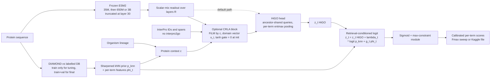

# Retrieval-conditioned HiGO can overtake GO-GPT

**Executive summary.** The model we recommend is **HiGO-R**, a retrieval-conditioned, per-term GO classifier. It keeps the existing HiGO head (ancestor-shared term queries, per-term entmax evidence pooling, max-constraint output). It adds an identity-sharpened kNN label prior to every term's logit, with a learned per-term trust. It reads a scalar mix of intermediate layers from a frozen, larger ESM2 encoder: 3B truncated at layer 30, or 650M if disk allows. A TRLA-style conditioned residual latent adapter (CRLA) is optional, and we build it only if a missing control shows that encoder adaptation matters. Every hyperparameter and blend is tuned on a temporal validation split built from dated annotations. The case for this design is measured, not assumed. **A zero-training, identity-sharpened kNN label copy already ties GO-GPT on GO-GPT's own temporal test: 0.691 for the setting picked on validation, against 0.687 for the released checkpoint, with a paired bootstrap difference of +0.005 and a 95% CI of [−0.0015, +0.012]** ([red-team note](../research_notes/Novel%20GO%20model%20beyond%20BioReason%20Pro/red_team.md)). GO-GPT's remaining edge lies in the 50–95% identity bins, about 35% of proteins. In those bins a model with GO-GPT's kind of encoder **and** direct access to neighbour labels should at least match it (inference). If that holds, the overall score should land at **about 0.70–0.72 (estimate)**. A significant win needs roughly +0.01 over whichever bar applies, and the novel model has to beat the sharpened kNN baseline in the same table, not just GO-GPT. The plan below costs about 50 GPU-hours before the first learned-model verdict (estimate). It needs no LLM, no autoregressive decoder and no 3D structures, and it starts with two CPU-only steps that already define the baseline every later step must beat.

## GO-GPT wins by memorising close homologs, and a kNN copy already ties it

GO-GPT is a frozen ESM2-3B encoder read at layer 30 of 36, feeding a roughly 200M-parameter prefix-causal GPT decoder. The decoder emits depth-sorted GO tokens from a 9,977-term vocabulary (terms with ≥20 training proteins) and is conditioned on one of 200 organism embeddings. It was trained on GOA November 2022 experimental labels, with a **random** 90/10 train/validation split, and the authors report that validation loss starts rising after about 20 of 100 epochs ([BioReason-Pro preprint](https://www.biorxiv.org/content/10.64898/2026.03.19.712954v1.full)). BioReason-Pro puts a Qwen3-4B reasoning model on top. That model consumes GO-GPT's predictions, InterPro text and ESM3 embeddings, and it was trained with GPT-5 traces plus RL on an IA-weighted F1 reward. In the paper it scores **0.66 weighted Fmax greedy against GO-GPT's 0.65**, and it was evaluated on no-knowledge proteins only ([BioReason-Pro preprint](https://www.biorxiv.org/content/10.64898/2026.03.19.712954v1.full)). The often-quoted "73.6% Fmax" is unweighted and cannot be compared with weighted numbers ([red-team note](../research_notes/Novel%20GO%20model%20beyond%20BioReason%20Pro/red_team.md)). Beating GO-GPT on GO Fmax is therefore close to beating BioReason-Pro on GO Fmax, because removing the GO-GPT input weakens BioReason-Pro. An independent analysis also found that **replacing BioReason-Pro's protein embedding with one computed from a shuffled sequence leaves Fmax unchanged** (0.855 vs 0.856) ([arXiv 2610.00898](https://arxiv.org/html/2610.00898)).

The comparison has four reference numbers. The paper reports **0.651**. The predictions shipped with the test set score **0.649**. The public checkpoint, which we reproduced with an independent evaluator to four decimals, scores **0.687** (MF 0.714, BP 0.617, CC 0.728) ([project report](../REPORT.md); [red-team note](../research_notes/Novel%20GO%20model%20beyond%20BioReason%20Pro/red_team.md)). The fourth number is unmeasured: the public checkpoint with the paper's ten-sample frequency scoring. If that scoring adds the paper's +0.02, the bar is about **0.705 (inference)**. The claim that the public checkpoint "was trained on more data" is speculation; a different checkpoint-selection epoch would explain the BP jump just as well.

**Why it wins.** GO-GPT's benchmark is mostly a nearest-neighbour label-transfer test. **88% of the 8,630 test proteins have a ≥50%-identity hit in GO-GPT's training split, 51% have a ≥95% hit, and about 25% a 100% hit** ([red-team note](../research_notes/Novel%20GO%20model%20beyond%20BioReason%20Pro/red_team.md)). Our current kNN dilutes the closest neighbour: it is a bitscore-weighted mean over up to 50 hits, with a median of 44 hits per query. The homology gate then mixes it in at g ≤ 0.6, and the grounded calibrator gives the kNN logit a weight of only 0.02–0.13 ([code audit](../research_notes/Beating%20BioReason%20Pro%20de%20novo/code_audit.md)). Sharpening fixes this. With weights \(w_j = \text{bits}_j \cdot e^{(\text{pident}_j - \max \text{pident})/T}\), kNN scores **0.685–0.701 across a 12-setting grid** with no training at all. It beats GO-GPT at ≥95% identity, where GO-GPT's 0.835 at 100% trails a best-hit copy (0.872) and the sharpened kNN (0.898) ([red-team note](../research_notes/Novel%20GO%20model%20beyond%20BioReason%20Pro/red_team.md)).

**Where it is weak**, per identity bin (mean of MF/BP/CC Fmax inside each bin, measured):

| method | all | 100% | 95–99.9% | 80–95% | 50–80% | 30–50% | <30% | no hit |
|---|---|---|---|---|---|---|---|---|
| share of test proteins | — | 25.4% | 28.2% | 15.8% | 18.9% | 8.0% | 0.9% | 2.9% |
| GO-GPT released (beam) | 0.687 | 0.835 | 0.829 | **0.657** | 0.469 | 0.438 | 0.402 | **0.374** |
| HiGO-35M + gate | 0.576 | 0.658 | 0.636 | 0.579 | 0.475 | 0.478 | 0.466 | 0.361 |
| sharpened kNN, T=2, top-10 (fixed a priori) | **0.699** | **0.898** | **0.851** | 0.640 | 0.409 | 0.427 | 0.435 | 0 |
| sharpened kNN, T=10, top-50 (val-selected) | 0.691 | 0.879 | 0.836 | 0.618 | 0.444 | 0.463 | 0.451 | 0 |

Source: [red-team note](../research_notes/Novel%20GO%20model%20beyond%20BioReason%20Pro/red_team.md), §3.2.

Four failure modes stand out. First, **GO-GPT emits binary sets**: greedy decoding scores 0.65, ten-sample frequencies 0.67 and the best-of-10 oracle 0.70, so poor per-term scoring costs it 0.02–0.05 ([BioReason-Pro preprint](https://www.biorxiv.org/content/10.64898/2026.03.19.712954v1.full)). Second, **it memorises rather than generalises**. It scores 0.897 zero-shot on CAFA-6 proteins that are 96% present in its own training data, against 0.687 on its temporal holdout, and the v2 model card concedes that training proteins "get memorized" ([project report](../REPORT.md); [GO-GPT v2 card](https://huggingface.co/wanglab/gogpt-v2)). Third, **it has no channel for retrieval, domains or electronic annotations**, and its fixed vocabulary of 200 organisms and ≥20-protein terms means "rarer terms are never predicted" ([GO-GPT v2 card](https://huggingface.co/wanglab/gogpt-v2)). Fourth, **it is beaten below 50% identity** by HiGO-35M with the gate (0.478 vs 0.438 at 30–50%; 0.466 vs 0.402 below 30%), but that stratum is worth only about 0.001 overall per +0.01. BioReason-Pro adds its own failure modes: InterPro entries fabricated for domain-less peptides, and organism-label sensitivity, where the same sequence is called a ribosomal protein or a transcriptional repressor depending on the organism label ([BioReason-Pro preprint](https://www.biorxiv.org/content/10.64898/2026.03.19.712954v1.full)).

The arithmetic of the bins dictates the plan. Each +0.01 is worth about 0.0025–0.0028 overall in each ≥95% bin, 0.0016–0.0019 in each 50–95% bin, and less than 0.001 in each remote bin ([red-team note](../research_notes/Novel%20GO%20model%20beyond%20BioReason%20Pro/red_team.md)). Our scenario (inference) combines the kNN's ≥95% scores, GO-GPT's 0.657 in the 80–95% bin and about 0.48 in the lower bins. That gives **about 0.715**, close to the test-oracle ceiling of the zero-training blends (0.711–0.717). Those oracle blends tune weights on test and must never be reported.

## HiGO-R conditions every GO term on its neighbours' labels

HiGO-R has three new blocks on top of the existing HiGO head (`src/cafa6/model.py`). They target the three things GO-GPT has and we lack: a strong encoder read at the right depth, label memory for close homologs, and calibrated per-term scores. Unlike GO-GPT, HiGO-R sees neighbour labels directly.

**Block 1: retrieval-conditioned per-term logits.** For query \(q\), take the top-\(k\) DIAMOND hits \(j\). Each hit has bitscore \(b_j\), identity \(s_j\), query coverage \(c_j\) and a full propagated label set \(y_j\); the labels are not restricted to the vocabulary, so the kNN branch reaches out-of-vocabulary terms for free. The prior is

$$
w_j = b_j \, \exp\!\Big(\tfrac{s_j - \max_i s_i}{T}\Big)\, c_j^{\gamma}, \qquad
p^{\text{knn}}_t = \min\!\Big(1,\ \frac{\sum_j w_j\, y_{jt}}{\sum_j w_j}\Big),
$$

and the per-term evidence vector is \(\phi_t = [\,s^{*}_t,\ f_t,\ n_t,\ \max_i s_i,\ \mathbb{1}[\text{hit}],\ \mathrm{IA}_t,\ \mathrm{depth}_t\,]\). Here \(s^{*}_t\) is the best identity among hits carrying term \(t\), \(f_t\) the fraction of hits carrying it, and \(n_t\) their count. The fused logit and output are

$$
z_t = z^{\text{HiGO}}_t + \lambda_t\,\mathrm{logit}\big(\mathrm{clip}(p^{\text{knn}}_t, \epsilon, 1-\epsilon)\big) + g_t^{\top}\phi_t,\qquad
\lambda_t = \mathrm{softplus}(a_{\text{aspect}} + \delta_t + \beta^{\top}\psi(\max_i s_i)),\qquad
\hat p = \mathrm{MCM}(\sigma(z)).
$$

\(\psi\) is a radial-basis encoding of top identity, and \(\delta_t\) is a small per-term offset with strong weight decay. With no hit, the prior term is dropped and the model falls back to \(z^{\text{HiGO}}\), which is where HiGO already beats GO-GPT. This block targets **the 80–95% and 50–80% bins and the post-hoc gate's inability to express per-term trust**. Two existing defects motivate it: the current gate is a per-aspect scalar over three protein-level features, and the calibrator's clipped-logit kNN feature collapses to a constant ([codebase inventory](../research_notes/Novel%20GO%20model%20beyond%20BioReason%20Pro/codebase_inventory.md)). The design follows the kNN-LM idea of interpolating a parametric model with a neighbour distribution ([kNN-LM, ICLR 2020](https://arxiv.org/abs/1911.00172)) and InterLabelGO+'s identity-driven DL/kNN weighting, which gave +0.016 on CAFA-5 ([InterLabelGO+, Bioinformatics 2024](https://pmc.ncbi.nlm.nih.gov/articles/PMC11568131/)).

An optional second variant follows TabR: an attention read over neighbour labels,
\(r = \sum_j \mathrm{softmax}_j\!\big(-\lVert k_q - k_j\rVert^2\big)\,\big(W_y \tilde y_j + U(k_q - k_j)\big)\),
which the term queries can attend to. TabR showed that removing the context labels drops performance back to MLP level ([TabR, ICLR 2024](https://proceedings.iclr.cc/paper_files/paper/2024/file/4ef594af0d9a519db8fb292452c461fa-Paper-Conference.pdf)). Retrieval-augmented protein models support the general direction ([PoET-2, NeurIPS 2025](https://proceedings.neurips.cc/paper_files/paper/2025/file/4d19160864e6a644496d61b21c7e015a-Paper-Conference.pdf); [Protriever, ICML 2025](https://proceedings.mlr.press/v267/weitzman25a.html)). The only GO-specific evidence, ProtEx, is a preprint ([ProtEx, bioRxiv](https://www.biorxiv.org/content/10.1101/2024.05.30.596539v2)). To keep the model from learning only "copy the top hit", training samples an identity cap per batch. The starting guess is no retrieval 0.25, ≤30% 0.25, ≤50% 0.20, ≤70% 0.15 and uncapped 0.15 ([adapters note](../research_notes/Novel%20GO%20model%20beyond%20BioReason%20Pro/adapters_trla.md)). Because 51% of test proteins sit at ≥95%, the uncapped share is a tuning knob to set on temporal validation, not a constant (inference).

**Block 2: intermediate-layer readout of a frozen larger encoder.** HiGO currently reads only `last_hidden_state` of ESM2-35M (`model.py:94`). HiGO-R replaces that with

$$
H_{\text{read}} = \mathrm{LN}\Big(\sum_{l \in R} \mathrm{softmax}(w)_l\, \mathrm{LN}_l\big(h^{(l)}\big)\Big),\qquad R_{3B} = \{18, 22, 26, 30\},\ R_{650M} = \{18, 22, 26, 30, 33\},
$$

with the 3B encoder truncated after layer 30 and run under `no_grad`. The per-layer LayerNorm is required because Hugging Face ESM2 normalises only the final output ([adapters note](../research_notes/Novel%20GO%20model%20beyond%20BioReason%20Pro/adapters_trla.md)). This targets **representation quality for moderately close homologs**, the 50–95% bins. The evidence: GO-GPT found that intermediate layers at 80–90% depth beat the final layer and that ESM2-650M ≈ 3B while 150M is clearly worse ([BioReason-Pro preprint, App. B.3](https://www.biorxiv.org/content/10.64898/2026.03.19.712954v1.full)). SaProt's table shows ESM2 35M→650M at +0.05–0.07 GO Fmax, on a non-temporal split ([SaProt, ICLR 2024](https://proceedings.iclr.cc/paper_files/paper/2024/file/1c42513b8895ab11fbbb5b7e8e6b6b02-Paper-Conference.pdf)). The ICML 2024 transfer study warns that many protein tasks do not scale ([Li et al., ICML 2024](https://proceedings.mlr.press/v235/li24a.html)), and PoET-2 reports neutral or negative scaling for function prediction ([PoET-2, NeurIPS 2025](https://proceedings.neurips.cc/paper_files/paper/2025/file/4d19160864e6a644496d61b21c7e015a-Paper-Conference.pdf)). Our synthesis (inference): 35M→650M probably helps the 50–95% bins, 650M→3B probably does not, and neither moves the ≥95% bins, where retrieval dominates. A frozen, truncated 3B costs about 0.22× the per-step compute of the current LoRA-3B setup, so the same wall-clock buys 4–5× more optimisation steps (estimate).

**Block 3 (optional stage): conditioned residual latent adapter, CRLA.** TRLA (Wu et al.) is an **ICML 2026 GenBio workshop poster**, not a main-track paper. It places a 4.7M-parameter token-wise residual MLP between a frozen ProtT5-3B encoder and its decoder, trained with a paired latent MSE for fitness ([OpenReview forum](https://openreview.net/forum?id=ZUBNaqRSDL)). Only the architectural idea transfers, a per-residue nonlinear residual edit of frozen states; the training signal does not. Our notes also lost the PDF details (width, initialisation), so "TRLA-style" here means the generic form, and the conditioning is our addition:

$$
a_i = W_{\text{down}}\,\mathrm{LN}(h_i) + b_{\text{down}},\qquad
a_i \leftarrow (1 + \Gamma c)\odot a_i + B c + D u_i,\qquad
h_i' = h_i + \tanh(\alpha)\,\big(W_{\text{up}}\,\mathrm{GELU}(a_i) + b_{\text{up}}\big),\quad \alpha_0 = 0 .
$$

\(c\) is the protein context (lineage embedding, retrieval summary, top identity), and \(u_i\) is a residue-level InterPro-span embedding built from computed signature IDs only. Because \(\alpha_0 = 0\), the block is an exact identity at step 0. \(W_{\text{up}}\) must **not** also be zeroed, or no gradient reaches the block. There are three placements: variant A, one block at the readout (the direct TRLA analogue, with no backprop into the encoder); variant B, interior blocks every second or third layer; and variant C, a ladder side network for 3B. The design draws on ReFT-style representation edits (LoReFT, NeurIPS 2024), Houlsby bottleneck adapters (ICML 2019) and Flamingo's zero-initialised tanh gates (NeurIPS 2022), all as summarised in the [adapters note](../research_notes/Novel%20GO%20model%20beyond%20BioReason%20Pro/adapters_trla.md), and on Ladder Side-Tuning, which saves 69% of fine-tuning memory ([LST, NeurIPS 2022](https://proceedings.neurips.cc/paper_files/paper/2022/hash/54801e196796134a2b0ae5e8adef502f-Abstract-Conference.html)). It targets **backprop cost through 3B and a residue-level place for domain, taxon and neighbour conditioning**. It stays optional for one reason: the frozen baseline in `REPORT.md` (`base_35m_frozen_mlp`) lacked the HiGO head (mean pooling, no hierarchical queries, no MCM, no taxon, no IA weight). The reported +0.022 "LoRA vs frozen" gain therefore confounds adapter and head, and **the adapter's own contribution is unmeasured** ([codebase inventory](../research_notes/Novel%20GO%20model%20beyond%20BioReason%20Pro/codebase_inventory.md); [project report §8.7](../REPORT.md)). LoRA r16 ≈ r8 and DoRA ≈ LoRA in our runs further suggest the adapter is not the bottleneck. The adapters note's own estimate of CRLA's gain is 0 to +0.01.

| component | failure mode targeted | identity bins expected to move | literature anchor (venue) |
|---|---|---|---|
| Sharpened kNN prior + per-term trust \(\lambda_t\) | Dilution of the nearest neighbour; the gate cannot trust per term | ≥80% | kNN-LM (ICLR 2020); InterLabelGO+ (Bioinformatics 2024) |
| TabR-style neighbour attention (variant) | Label co-occurrence for moderately close homologs | 50–95% | TabR (ICLR 2024); PoET-2 (NeurIPS 2025); Protriever (ICML 2025) |
| Identity-capped neighbour sampling | Collapse onto copying; loss of the remote-homolog lead | <50% must not drop | TabR leave-self-out (ICLR 2024); LP-FT (ICLR 2022) |
| Frozen 650M/3B, scalar-mix readout | 35M capacity gap; last layer is shaped for masked-token prediction | 50–95% | GO-GPT App. B.3 (preprint); SaProt (ICLR 2024); Li et al. (ICML 2024) |
| CRLA (optional) | Backprop cost at 3B; no residue-level conditioning | all, small | TRLA (ICML 2026 GenBio workshop); LoReFT (NeurIPS 2024); LST (NeurIPS 2022) |
| MCM output, shared Fmax threshold | Binary, uncalibrated outputs in GO-GPT | all | C-HMCNN (NeurIPS 2020); Koyejo et al. (NeurIPS 2015) |

## What HiGO-R leaves out, and why

**No LLM reasoning layer.** BioReason-Pro's reasoning adds about +0.01 over greedy GO-GPT and is no better than GO-GPT's ten-sample mode (0.66 vs 0.67). The cost is a 4B LLM, GPT-5 traces for 130k proteins, and about 32 h of RL on 8 H100s ([BioReason-Pro preprint](https://www.biorxiv.org/content/10.64898/2026.03.19.712954v1.full)). The shuffled-sequence result suggests the LLM acts as a re-ranker over GO-GPT and InterPro text ([arXiv 2610.00898](https://arxiv.org/html/2610.00898)), and a learned stacker can do that cheaply.

**No autoregressive decoding.** CAFA Fmax is instance-averaged F with one global threshold. For that family of metrics, thresholding calibrated per-label marginals with a shared threshold is Bayes-optimal, and label dependence matters only through the threshold ([Koyejo et al., NeurIPS 2015](https://proceedings.neurips.cc/paper/2015/file/85f007f8c50dd25f5a45fca73cad64bd-Paper.pdf)). CAFA's `norm=cafa` variant is not exactly covered by the theorem. Seq2seq decoding of sets depends on an arbitrary output order ([Vinyals et al., ICLR 2016](https://arxiv.org/abs/1511.06391)), and GO-GPT's own beam search gave no gain. Rebuilding an AR decoder would copy GO-GPT's design where kNN already beats it.

**No diffusion over label sets.** We found no GO evidence for it, and a discrete-diffusion multi-label study reports that joint set refinement lowers F1 ([arXiv 2608.14649](https://arxiv.org/abs/2608.14649)).

**No full 3D structure.** Full-coordinate methods need stored structures that do not fit in 3.9 GB. Structure gains are +0.01–0.03 on non-temporal PDB benchmarks ([SaProt, ICLR 2024](https://proceedings.iclr.cc/paper_files/paper/2024/file/1c42513b8895ab11fbbb5b7e8e6b6b02-Paper-Conference.pdf); [ProSST, NeurIPS 2024](https://proceedings.neurips.cc/paper_files/paper/2024/file/3ed57b293db0aab7cc30c44f45262348-Paper-Conference.pdf)). PoET-2 found structure gave little benefit for supervised function prediction ([PoET-2, NeurIPS 2025](https://proceedings.neurips.cc/paper_files/paper/2025/file/4d19160864e6a644496d61b21c7e015a-Paper-Conference.pdf)). Remote homologs are only about 12% of this test. ProstT5-predicted 3Di tokens stay parked as a late, CAFA-6-motivated step ([ProstT5](https://academic.oup.com/nargab/article/6/4/lqae150/7901286)).

**Also deferred or rejected:**
- **A GO-text label encoder.** GO-GPT saw no gain from text-initialised tokens, and 93.8% of test IA mass is already inside our 7,901-term vocabulary.
- **BioReason-Pro's `go_embedding.pt`.** Its provenance is unknown, and using it muddies the de novo claim.
- **Semantic probabilistic layers.** They win on exact match, not Hamming score ([SPL, NeurIPS 2022](https://proceedings.neurips.cc/paper_files/paper/2022/file/c182ec594f38926b7fcb827635b9a8f4-Paper-Conference.pdf)).
- **Protein-text pretraining.** It is worth at most +0.015 ([ProtST, ICML 2023](https://proceedings.mlr.press/v202/xu23t/xu23t.pdf)).
- **The GO-GAT in its current form.** Our pilot lost 0.018.
- **Current-release `interpro2go` and GOA in any headline number.**
- **An ensemble with GO-GPT as the headline.** It can appear only as a separate, labelled row.

## Data, objective and leakage rules

**Temporal validation (TV) comes first.** On GO-GPT's random validation split, the kNN settings rank almost in reverse of their test order (validation 0.554–0.579). Per-bin blend weights fit on validation reach only 0.687, against 0.711 with test-tuned (oracle) weights ([red-team note](../research_notes/Novel%20GO%20model%20beyond%20BioReason%20Pro/red_team.md)). The grounded calibrator reversed sign on the temporal test (0.550 vs 0.576 for the gate) for the same reason ([project report §8.4](../REPORT.md)). TV construction for the GO-GPT benchmark:

1. Choose T0 = 2021-11-30.
2. From the dated `goa_reference.parquet`, take GO-GPT training proteins that gained experimental annotations (EXP, IDA, IPI, IMP, IGI, IEP, TAS, IC) after T0 and before the November 2022 cutoff, in an aspect with none before T0. These are no-knowledge and limited-knowledge proteins, as in CAFA.
3. Strip those post-T0 labels from the training labels and from the kNN database labels.
4. Keep GO-GPT's random validation split for early stopping only.
5. Report TV's organism mix and identity distribution next to the test's.

The file covers 10 reference proteomes with **no zebrafish, while zebrafish is 45% of the test**. A dated ZFIN GAF download should close that gap. If TV and test disagree on the ranking of the zero-training variants by more than the bootstrap CI, select on the most test-like TV subset instead ([red-team note](../research_notes/Novel%20GO%20model%20beyond%20BioReason%20Pro/red_team.md)). Precedents for this kind of split are NetGO 3.0's validation year and the CAFA-5 3rd-place time-based validation ([NetGO 3.0](https://pmc.ncbi.nlm.nih.gov/articles/PMC10626176/); [tito write-up](https://www.kaggle.com/its7171/writeups)).

**Date cutoffs per benchmark.** For the GO-GPT benchmark:
- Training labels are GOA November 2022 as released by GO-GPT, with GO 2023-01-01 and the CAFA-5 IA file.
- The tuning-time kNN database is the 119,749 training proteins only.
- The final model may add the 13,305 validation proteins to the database.
- Every feature source must be dated on or before November 2022 / January 2023.

For the CAFA-6 local replica:
- Training labels are as of 2025-06-18 (`train_terms.tsv`, GO 2025-06-01).
- Features may be dated on or before 2026-02-02.
- The local temporal validation targets are experimental pairs dated 2025-06-18 to 2026-02-02.
- **The 5,158 local GOA experimental pairs dated after 2026-02-02 are essentially final ground truth and must never enter features or labels** ([Kaggle note](../research_notes/Novel%20GO%20model%20beyond%20BioReason%20Pro/kaggle_competition.md)).

**IEA and InterPro as features, never as targets.** GO-GPT found IEA-as-targets did not help. ProtBoost found IEA-as-features worth +0.02, noting that "about 30% of electronic labels becomes experimental" ([ProtBoost, arXiv 2412.04529](https://arxiv.org/abs/2412.04529); [U900 write-up](https://www.kaggle.com/competitions/cafa-5-protein-function-prediction/writeups/u900-private-2nd-public-5th-solution-py-boost-and-)). That 30% is exactly why current IEA leaks. Our GOA is a 2026 file, and a date filter on it is not equivalent to a 2022 snapshot: removed and obsoleted annotations are missing, and IEA rows carry the date of the last pipeline run (inference; check the date distribution). Our `interpro2go` was never date-filtered. The rules:
- InterPro **signature IDs** (computed matches, 98% coverage) enter as learned tokens or pooling priors; `interpro2go` is not used.
- IEA features come only from dated `goa/old/` archives, which ProtBoost used ([ProtBoost](https://arxiv.org/html/2412.04529)).
- Curated fields (protein names, function text, EC, binding sites) are used for training and reference proteins only.
- Any run using current-release mappings is reported separately as "possibly leaky".

**Objective.** Keep the IA-weighted C-HMCNN MCLoss with MCM output, since `prop=max` evaluation rewards ancestor-closed scores ([C-HMCNN, NeurIPS 2020](https://proceedings.neurips.cc/paper/2020/file/6dd4e10e3296fa63738371ec0d5df818-Paper.pdf)). Fix two cheap defects ([codebase inventory](../research_notes/Novel%20GO%20model%20beyond%20BioReason%20Pro/codebase_inventory.md)): initialise `term_bias` at the logit of the term prior instead of zero, and remove weight decay from embeddings, LayerNorms and biases. Three candidates are ablations, never defaults, because our own IA-weighting ablation was null to negative (+0.001 val, −0.009 test, under a 4-epoch confound):
- IA-weighted soft-F1 multiplied with ZLPR, as in InterLabelGO+; soft-F1 alone performs poorly ([InterLabelGO+](https://pmc.ncbi.nlm.nih.gov/articles/PMC11568131/));
- ProtBoost-style parent masking;
- logit adjustment, which targets balanced error rather than Fmax ([Menon et al., ICLR 2021](https://arxiv.org/abs/2007.07314)).

Under PU-style corrections, unannotated-but-true terms gain score, but the benchmark counts those terms as false positives, so such corrections can lower measured Fmax.

## An experiment ladder that kills bad ideas cheaply

The rules, adapted from the red-team ladder ([red-team note](../research_notes/Novel%20GO%20model%20beyond%20BioReason%20Pro/red_team.md)):
- Fixed budget, one change per step.
- Metric: IA-weighted Fmax on **TV**, overall and per identity bin, with the CAFA-6 clustered validation as a guardrail. No step may lower the guardrail by more than 0.005.
- At least 2 seeds for every learned component.
- Keep or drop is decided before any test look.
- The GO-GPT test is opened at most four times (after P3, after L3, after L5 and at the end), and each look is logged in `test_looks.md`.

The adapters note's decision rules were written against random-split validation (0.5270); they are restated here on TV. Budgets are estimates from measured throughput: 35M runs at about 41 min/epoch on GO-GPT data, and 3B LoRA at about 2.4 GPU-h/epoch on CAFA-6.

| step | hypothesis | budget (GPU-h) | metric on TV | keep / drop rule | code files touched |
|---|---|---|---|---|---|
| P0 | GO-GPT code and training parquet survive a reboot | 0 | — | **Done**: `external/gogpt_tmp_backup/` (179 MB); repoint imports there | `benchmarks/gogpt_eval.py` (L47), `prepare_gogpt.py` (`/tmp/gogpt_train`) |
| P1 | Enough disk for sparse outputs and later downloads | 0 | — | User decides what to free; switch to sparse top-k predictions first | `train.py` `predict`, `evaluate.py` `dense_to_long` / temp dir |
| P2 | A dated split ranks settings like the test does | ~4 CPU-h | Ranking of the L0 variants | Proceed if TV ranks match within the CI; else use a test-like TV subset | new `temporal_val.py`; `prepare_gogpt.py`; `grounding_data.py` (ZFIN) |
| P3 | Frozen protocol prevents test tuning | 0 | — | Evaluator settings, comparison rows and bootstrap (≥1,000 reps) fixed | `bench_gogpt.py`, `prf_table.py` |
| L0 | Identity sharpening + coverage beats the bits-weighted mean | ~2 CPU-h | Overall, ≥80% bins | Always report the best variant as the baseline; between variants within 0.003, pick the simplest | `homology.py` (`diamond_score`), `baselines.py` |
| L1 | A per-term post-hoc stacker over [p_knn, s*_t, f_t, IA, depth, HiGO prob, has-hit] beats L0 | ~3 CPU-h | Overall; remote bins | Keep if ≥ +0.005 over L0 and remote bins ≥ gate − 0.005 | `stack.py`, `grounded.py` (`components`, raw p_knn instead of the clipped logit) |
| L2 | The bar is ~0.705 with ten-sample scoring (T 0.7, top-k 20) | 6–10 | Test (defines the target) | — | `benchmarks/gogpt_eval.py` (`--sample`, frequency scoring) |
| L3 | The adapter matters: C0 frozen 35M + full HiGO head vs C1 LoRA, trained to convergence on GO-GPT data minus TV labels | ~28 (4 runs × ~7) | Overall + bins | If C1 − C0 ≥ 0.01, keep LoRA; otherwise all scaling goes frozen and CRLA is dropped | `train.py` (empty param group, cosine horizon = epochs run, DDP, resume), `model.py`, `configs/` |
| L4 | Retrieval inside the network beats the post-hoc stacker: (a) per-term prior only, (b) + TabR attention | ~16 (2 × ~8) + CPU for train-vs-train hits | 50–95% bins; ≥95% bins | Keep if ≥ +0.01 over **L1** in the 50–95% bins and the ≥95% bins are not below L0; drop (b) if within 0.005 of (a) | `model.py` (`forward`), `train.py` (`Batcher` neighbour ids), `homology.py`, `explain.load_run`, `dump_preds.py`, `sae.py`, `predict_grounded.py` |
| L5 | Frozen 3B at layer 30 with scalar-mix readout (or 650M) helps the 50–95% bins | 10–15 | 50–95% bins at equal wall-clock | Keep if ≥ +0.01 over the same head on 35M; else stay on 35M/650M | `model.py` (`build_backbone`, readout hook as in `gogpt_eval.esm_layer`), `configs/final_3b.yaml`, `train.py` (DDP) |
| L6 | Loss variants help (soft-F1 × ZLPR, parent masking, logit adjustment, positive re-weighting); 35M, in parallel | ~28 (4 × ~7) | Overall | Keep only if ≥ +0.005 with 2 seeds agreeing | `model.py` (`loss`) |
| L7 | InterPro IDs as learned tokens / pooling priors add signal | ~8 | Overall; MF | Keep if ≥ +0.005; never use current mappings in the headline | `train.py` (`Batcher.crop` must return offsets), `model.py`, `uniprot_features.parquet` loader |
| L8 | OOV terms via kNN, then min_count 10 | CPU, then ~8 | Overall; high-IA tercile | Keep if ≥ +0.003 overall or ≥ +0.01 in the high-IA tercile | `prepare_gogpt.py` (`min_count`), sparse storage in `train.predict` |
| L9 | CRLA (variant A/C) on 3B adds to a frozen readout | ~15 | Overall | Run only if L3 showed LoRA matters and L5 used frozen; keep if ≥ +0.005; drop if "retrieval in head only" is within 0.005 | `model.py` (forward hooks), all four run loaders |
| L10 | Label-query self-attention over the top-256 candidates | ~10 | Overall | Keep if ≥ +0.005 | `model.py` |
| L11 | ProstT5 3Di tokens help remote homologs | ~10 + ~3 GB disk | Remote bins | Parked by default; keep only if remote bins ≥ +0.02 (justified by CAFA-6, not GO-GPT) | `train.py` (`Batcher.encode`), `model.py` |
| L12 | Final model | ~20 | One test look | Retrain on train+val with TV labels restored and settings frozen; 3 seeds; seed ensemble; separate "uses GO-GPT outputs" row | `configs/`, `tools/` |

L0–L5 total about 50–60 GPU-hours plus CPU time (estimate), which fits in a few days on two H100s once DDP exists. Steps L0 and L1 cost no GPU time and set the baseline that every learned step must beat; GO-GPT is no longer that baseline.

## Evaluation protocol and the claims we may make

**The protocol is fixed before the first learned run.** Its elements:
- The same 8,630 proteins and propagated ground truth, with GO 2023-01-01, CAFA-5 IA, cafaeval `prop=max`, `norm=cafa` and 0.01 threshold steps, as already wired in `bench_gogpt.py`.
- Two subsets: S3_all, and S6, the 8,159 no-knowledge proteins (GO-GPT 0.702, val-selected kNN 0.709).
- Per-aspect and mean scores, weighted and unweighted.
- Identity bins on coverage-aware max identity; IA terciles; NK vs LK.
- A paired protein bootstrap with ≥1,000 replicates and Holm correction across aspects, matching GO-GPT's own 10,000-iteration test ([BioReason-Pro preprint](https://www.biorxiv.org/content/10.64898/2026.03.19.712954v1.full)).
- Every table carries rows for 0.651, 0.649, 0.687, the L2 ten-sample number, the sharpened kNN, the L1 stacker and HiGO + gate.

The 95% half-width is about 0.007, so a significant win needs about +0.01 ([red-team note](../research_notes/Novel%20GO%20model%20beyond%20BioReason%20Pro/red_team.md)). Two metric effects must be disclosed if they occur:
- **Abstention.** kNN abstains on no-hit proteins, and `norm=cafa` averages precision only over proteins with predictions, so abstention raises measured Fmax. The count-weighted bin formula gives 0.684 for kNN against 0.699 measured.
- **Limited-knowledge overlap.** 760 test proteins are limited-knowledge proteins present in GO-GPT's training set. Self-hits are excluded by accession, so we do not use their own other-aspect labels; if we ever do, that goes on a separate LK row.

**We may claim:**
- **HiGO-R beats GO-GPT on its own temporal test** only if HiGO-R beats the public checkpoint, the ten-sample bar **and** the L1 stacker, with a paired bootstrap CI excluding zero, and the kNN row is shown in the same table.
- **The win comes from the 50–95% bins** only if the per-bin deltas show it.
- **HiGO-R is better below 50% identity**, which current numbers already support.
- **HiGO-R outputs calibrated, hierarchy-consistent per-term scores with evidence maps**, with zero violations, which GO-GPT does not provide.

**We may not claim:**
- A new architecture beats GO-GPT without the kNN row.
- We beat "BioReason-Pro" in general. A narrow statement holds only on GO Fmax against its reported 0.66, on a different subset, and says nothing about explanations.
- Any comparison against 0.651 alone.
- Any number tuned or blended on test, including the 0.711 oracle.
- Any number using current-release `interpro2go` or GOA as if it were leak-free.
- Kaggle comparability of the clustered-split 0.541, which measures recovery of existing annotations.

## Kaggle CAFA-6: a late submission plus a local temporal replica

The competition is closed. Final submissions were due 2026-02-02 and the final evaluation was 2026-06-01. **GOAlpha won with 0.52430 private**, ahead of 0.48731 and 0.44640; about 0.425 was needed for the top 10 ([leaderboard](https://www.kaggle.com/competitions/cafa-6-protein-function-prediction/leaderboard)). The metric is IA-weighted Fmax per aspect, averaged within each knowledge category (no, limited and partial knowledge) and then across categories. **For partial-knowledge proteins, terms known before the deadline are excluded from scoring** ([competition overview](https://www.kaggle.com/competitions/cafa-6-protein-function-prediction/overview); [CAFA-evaluator-PK](https://github.com/claradepaolis/CAFA-evaluator-PK)). The winner combined BLAST-, PPI- and Foldseek-kNN, SVM-ESM2, LR-InterPro and two literature components through XGBoost learning-to-rank. That ranker was trained on a 1,000-protein validation set sampled to match the test species mix ([1st place write-up](https://www.kaggle.com/competitions/cafa-6-protein-function-prediction/writeups/1st-place-solution-for-the-cafa-6-protein-function)). The 2nd- through 6th-place teams all used GOA non-experimental evidence as features ([2nd place](https://www.kaggle.com/competitions/cafa-6-protein-function-prediction/writeups/2nd-solution-of-cafa-6-py-boost-gcn-articles-da); [6th place](https://www.kaggle.com/competitions/cafa-6-protein-function-prediction/writeups/6th-place-solution-for-the-cafa-6-protein-function)).

Our plan has three parts.

**A local temporal replica, built first.**
- Labels as of 2025-06-18 (82,404 proteins).
- Targets: experimental GOA pairs dated 2025-06-18 to 2026-02-02 (16,736 pairs on 8,681 proteins dated after 2025-06-18, minus the 5,158 after the deadline).
- Each pair classified as NK, LK or PK per aspect. The 36,775 training proteins with all three aspects are PK candidates and the other 45,629 are LK candidates.
- Scoring with CAFA-evaluator-PK, with `-known` set to the training pairs, and the categories averaged as Kaggle does ([Kaggle note](../research_notes/Novel%20GO%20model%20beyond%20BioReason%20Pro/kaggle_competition.md)).
- It covers only the 10 local proteomes, so it is a guide, not a leaderboard proxy.

**Partial-knowledge handling.**
- Keep self-hit exclusion for homology transfer.
- Feed each protein's own labels in other aspects as features. This is legal, and the 2nd place team got a consistent small gain from SVD of cross-aspect labels.
- Feed a protein's own same-aspect labels as context.
- Drop all known (protein, term) pairs from the output, as the 5th and 11th place teams did ([5th place](https://www.kaggle.com/aypyaypy/writeups); [11th place](https://www.kaggle.com/competitions/cafa-6-protein-function-prediction/writeups/11th-place-solution)).
- Max-propagate, sort rows by descending score, and keep the top-k per protein and aspect under the 1,500-term cap.

**A late submission.**
- Submit if Kaggle still scores late entries. The 11th place team's post-reveal variants suggest it does, but this is unverified without login.
- Use only data dated on or before 2026-02-02.
- Keep a separate row for the HiGO-R stack fed with dated non-experimental GOA features, since that is the lever every top-6 team used and we lack.

The 2nd place team also copied newly experimental labels from a release available at the deadline. That was legal then, but it is not a modelling result, and we should not replicate it in a reported score.

## Risks, prerequisites and open questions

**Prerequisites.** P0 is done: the GO-GPT `/tmp` source and training parquet are backed up to `cafa6/external/gogpt_tmp_backup/` (179 MB). The imports in `benchmarks/gogpt_eval.py` and the cache path in `prepare_gogpt.py` still point at `/tmp` and should be repointed. **Free disk is about 3.9 GB.** `grounding_data.py` refuses to run below 5 GiB, the ESM2-650M download (2.6 GB) would leave almost nothing, and `evaluate()` writes TSVs inside `PROC`. Candidates to free, all user decisions:
- the uncompressed 1.1 GB submission, which has a `.gz` copy;
- `~/.cache/pip` (2.9 GB);
- unrelated Hugging Face models (Bio_ClinicalBERT 3.0 GB, MOMENT 1.3 GB, Geneformer 1.2 GB);
- `~/.cache/torch/hub` (2.6 GB).

Sparse top-k prediction storage should land before any vocabulary growth. Each dense GO-GPT prediction pair is 136–210 MB per run ([codebase inventory](../research_notes/Novel%20GO%20model%20beyond%20BioReason%20Pro/codebase_inventory.md)).

**Risks.**
- **TV may not resemble test**: no zebrafish, a different identity mix, and GO-GPT cannot be scored on TV because it trained on those labels.
- **The learned retrieval model may only learn to copy** and add nothing over the L1 stacker. The L4 kill rule exists for this.
- **3B throughput.** The earlier LoRA-3B run never finished an epoch-2 pass, and there is no DDP code yet.
- **Silent engineering failures.** `load_state_dict(strict=False)` drops new weights without error across four run loaders, and `train_log.jsonl` append mode makes `cv_summary.py` ignore reruns.
- **The ten-sample GO-GPT bar may be higher than 0.705**, which would shrink the margin.
- **The TRLA mechanism details used here are reconstructions.** The PDF was not re-read in the second session, so CRLA should be described as TRLA-inspired, not as a reproduction.

**Open questions.**
1. Does frozen 35M with the full HiGO head match LoRA (L3)? The answer decides whether CRLA is built at all.
2. Is a dated ZFIN GAF small enough to download, and does adding it make TV rank settings like the test?
3. Do dated GOA and `interpro2go` archives from November 2022 or earlier exist for the test organisms in `goa/old/`?
4. Does the GO-GPT test include high-throughput evidence codes (HTP, HDA and others), which our TV label filter must match?
5. Does Kaggle still accept late submissions, and are they scored on the private 50% only?
6. How much of HiGO-R's eventual gain survives on CAFA-6's clustered split, where only 19% of test proteins have a ≥50% hit (inference from the red-team note)?

## Conclusion

The most useful finding is that the benchmark everyone cites as state of the art can be tied by copying labels from the nearest training sequences. That changes the target. The question is no longer how to build a bigger generative model than GO-GPT, but how to beat a sharpened kNN in the 35% of proteins at 50–95% identity, while keeping that kNN's 0.85–0.90 at ≥95% and HiGO's lead on remote homologs. HiGO-R is built for that question: per-term trust in neighbour labels, a frozen encoder read at the depth GO-GPT itself found best, and an adapter that has to earn its place against a control we never ran.

The second implication is procedural. Every past regression in this project (the calibrator, the blend weights, the kNN temperature) came from tuning on a random split and evaluating on a temporal one. A temporal validation split, a frozen protocol and a logged test-look budget are therefore what make any eventual "beats GO-GPT" claim survive review, and they cost CPU hours, not GPU hours.
