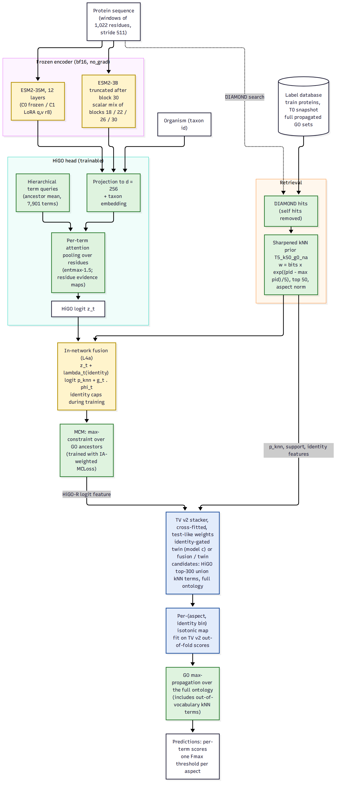

# HiGO-R2 model specification

Date: 2026-10-12, about 09:00. Documentation only: no code, config or run was changed to write this file.

This file is the authoritative specification of HiGO-R2. It merges two independent per-niche designs,
`reports/HiGO-R2_design.md` (called "design R" below) and `research_notes/HiGO-R loop/design_decisions.md`
("design D"), and two ledgers, `reports/observations_ledger.md` ("ledger R") and
`research_notes/HiGO-R loop/observations.md` ("ledger D", O-numbers). It also folds in the run notes in
`runs/test_looks.md`, `runs/stacker_tv/README.md`, `runs/calibrate_tv/notes.md` and `runs/meanflow_pilot/notes.md`,
plus the session split in `coordination.md`. Where these sources disagree, section 4.2 checks the source files
and says which one is right.

Diagram: `docs/higo_r2_pipeline.png` (source `docs/higo_r2_pipeline.mmd`).

---

## 0. Result and final status (2026-10-12, 22:50; supersedes the RUNNING / PLANNED states below)

**Test look #3** (`runs/test_look/look3_l3c0_twin/`, `logs/look3.log`) scored the pipeline chosen by the
pre-registered rule (`runs/test_looks.md`, 08:52:00 / 09:20:00 / 22:48:00):
frozen ESM2-35M HiGO head (`runs/l3_c0_tv2`) + sharpened kNN over train + val references, combined by the twin
stacker fitted on TV v2, no calibration.

| GO-GPT temporal test, 8,630 proteins | MF | BP | CC | mean IA-weighted Fmax |
|---|---|---|---|---|
| **HiGO-R2 (look #3)** | **0.7378** | **0.6579** | **0.7576** | **0.7178** |
| GO-GPT ten-sample (the bar) | 0.7203 | 0.6296 | 0.7454 | 0.6984 |
| GO-GPT beam (released checkpoint) | 0.7143 | 0.6171 | 0.7284 | 0.6866 |

- Against ten-sample: **+0.0193 [+0.0138, +0.0250]**. Against beam: **+0.0312 [+0.0254, +0.0374]**. Paired
  protein bootstrap with 1,000 replicates; the scorer reproduced both GO-GPT rows exactly.
- **Per identity bin** (train-only best hit), HiGO-R2 against ten-sample: 100% 0.879 vs 0.842; 95-99.9% 0.858 vs
  0.836; 80-95% 0.675 vs 0.667; 50-80% 0.506 vs 0.493; 30-50% 0.480 vs 0.450; <30% 0.451 vs 0.461; no hit 0.342 vs
  0.382. HiGO-R2 loses the two remote bins, which hold 329 of 8,630 proteins (3.8%). That is the open weakness: a
  35M frozen encoder does not match GO-GPT's 3B decoder where there is no homologue.
- **Test looks used:** 3 of 4. Look #4 is reserved by the 22:55:00 optimiser rule.

**Component check on test (2026-10-18, `runs/eval_suite/`, descriptive; logged in `runs/test_looks.md`):**

| G-test, IA-weighted Fmax | MF | BP | CC | mean |
|---|---|---|---|---|
| HiGO-R2 pipeline (look #3) | 0.7378 | 0.6579 | 0.7576 | 0.7178 |
| component: sharpened kNN prior, train + val references | 0.7582 | 0.6488 | 0.7548 | 0.7206 |
| component: HiGO head alone | 0.5292 | 0.3873 | 0.5280 | 0.4815 |

- On test, the twin stacker does not add to its own kNN prior. It is behind by 0.0028 overall, ahead in BP and CC,
  and behind in MF. On TV v2 it added +0.0083 [+0.0040, +0.0120], so this TV v2 gain did not transfer.
- The margin over GO-GPT therefore comes from retrieval:
  - identity-sharpened label transfer with per-aspect normalisation;
  - over the full ontology;
  - with GO-GPT's validation proteins added as references.
- The pre-registered choice is not changed after seeing this, because that would be selection on test.
- A future claim that the learned part helps needs a new temporal split, or look #4 with a rule registered before it.

**Novel-protein generalisation** (`runs/eval_suite/identity_bins.tsv`, per-protein IA-weighted F1, HiGO-R2 vs GO-GPT
ten-sample):

| nearest training identity | n | HiGO-R2 | GO-GPT ten-sample |
|---|---|---|---|
| no hit | 250 | 0.133 | 0.286 |
| <30% | 79 | 0.335 | 0.352 |
| 30-50% | 694 | 0.341 | 0.375 |
| 50-80% | 1,627 | 0.407 | 0.414 |
| 80-95% | 1,360 | 0.611 | 0.597 |
| 95-99.9% | 2,430 | 0.819 | 0.789 |
| 100% | 2,190 | 0.845 | 0.801 |

- HiGO-R2 leads only at 80% identity and above.
- Its quality tracks homology more than GO-GPT's does. The Spearman correlation of per-protein weighted F1 with
  identity is 0.523 against 0.431, a difference of +0.092 [+0.075, +0.108].
- For novel proteins (no hit, or under 50% identity), GO-GPT is the better predictor.

**Hierarchy and GO embeddings:**
- **Hierarchy violations:** HiGO-R2 has 0 violations in 2.75M child-parent pairs. GO-GPT ten-sample has 2.87% of pairs,
  in 27.3% of proteins.
- **GO relationship retrieval:** HiGO's learned term queries recover direct GO neighbours with P@1 0.678 and R@10
  0.724. That compares with 0.384 / 0.401 for untrained vectors through the same ancestor-mean, and 0.154 / 0.126 for
  GO-GPT's token embeddings.
- **Statistics:** 51 of 56 primary paired comparisons against GO-GPT pass Holm-Bonferroni. These are weighted Fmax,
  Smin, AUPR and unweighted Fmax, per aspect and mean, against both GO-GPT rows. None of the significant differences
  favours GO-GPT.

**TV v2 decisions** (cross-fitted test-like mean Fmax of the stacked pipeline; raw kNN with train + val references
scores 0.7259):

| niche | decision | evidence (TV v2 test-like) | status |
|---|---|---|---|
| 1. Backbone | frozen ESM2-35M | 3B layer-mix stack 0.7306 (gated twin +0.0047 [+0.0008, +0.0084], under the +0.005 bar) vs 35M stack 0.7342 | 35M KEPT; frozen 3B DROPPED |
| 2. Adapter | none | LoRA stack: best gated twin +0.0028 [-0.0013, +0.0064], not kept; C1 - C0 = -0.0055 against the +0.01 rule | LoRA DROPPED; CRLA and LST not built, by rule |
| 3. Pooling | per-term query, entmax-1.5 cross-attention | unchanged from the earlier ablations | KEPT |
| 4. Hierarchy | MCM + MCLoss, max-propagation after the stacker | 0 violations in the look-3 file | KEPT |
| 5a. Retrieval prior | sharpened kNN T5_k50_g0_na, references train + val | +0.0091 [+0.0070, +0.0110] for adding val references (09:12:11) | KEPT |
| 5b. In-network fusion (L4a) | dropped | stack +0.0016 [-0.0021, +0.0050] over kNN | DROPPED |
| 6. Loss / optimiser | IA-weighted MCLoss; AdamW + cosine | Schedule-Free (twin 0.7271 / 0.7233) vs WSD + tail averaging (0.7283 / 0.7182), 2 seeds each: SF leads by 0.0020 with seed pairs disagreeing in sign; neither clears the +0.005 replacement bar (rule 22:55:00, result 2026-10-18) | AdamW + cosine KEPT; both alternatives DROPPED; look #4 not used |
| 7. Stacking | twin refiner, cross-fitted on TV v2 | +0.0083 [+0.0040, +0.0120]; gated twin +0.0067; logistic fusion +0.0000 | twin KEPT; fusion DROPPED |
| 8. Calibration | none on the stacker output | isotonic on the twin 0.7287 vs 0.7342 uncalibrated; kNN + isotonic +0.0031 kept but 0.7290 < 0.7312, so not chosen | isotonic DROPPED for the final pipeline |
| 9. Ensembling and seeds | single seed | not run | PLANNED, outside the delivered model |

**Seed spread of the HiGO feature in the stacker.** Five 35M frozen runs went through the same stacker: l3_c0_tv2
plus the four optimiser runs. Their twin scores are 0.7342, 0.7283, 0.7271, 0.7233 and 0.7182, with a mean of 0.7262
and an SD of about 0.006. Only l3_c0 passed the keep rule. Its +0.0083 TV v2 gain is therefore the top of a spread,
and the expected HiGO contribution for a new seed is close to zero on TV v2.
- The look-3 result stands as measured: one pre-registered look of a fixed file.
- How much of the +0.019 over GO-GPT comes from the HiGO feature, and how much from the sharpened train + val kNN, is
  not separated on test. Doing so would cost look #4.
- The cheapest next step that needs no test look: average the five HiGO runs in logit space before the stacker
  (niche 9), and keep the average only if it beats kNN by ≥ 0.005 on TV v2.

---

## 1. The bar and the evaluation protocol

### 1.1 The bar

| row on the GO-GPT temporal test (8,630 proteins, S3_all, IA-weighted Fmax, mean of MF/BP/CC) | value | source |
|---|---|---|
| GO-GPT paper (Table S3) | 0.651 | `runs/bench_gogpt/summary.tsv` |
| GO-GPT released checkpoint, beam | 0.6866 | same |
| **GO-GPT released checkpoint, ten-sample frequency (the bar)** | **0.6984** | `runs/gogpt_sample10/summary.tsv` |
| sharpened kNN, red-team grid best (all-norm, T 1-5, k 50) | 0.701 (no CI against the bar) | `research_notes/Novel GO model beyond BioReason Pro/red_team.md` §3.2 |
| HiGO-35M alone / + homology gate | 0.4547 / 0.5759 | `runs/bench_gogpt/summary.tsv` |

The paired protein bootstrap 95% half-width on this test is about 0.007, so a win the bootstrap can see needs about
**0.708**. HiGO-R2 must also beat the sharpened kNN row and the stacked kNN row on the same test with a paired
bootstrap. The registered kNN row `T5_k50_g0_na` (aspect normalisation) has no test score yet. Scoring is cafaeval
prop=max, norm=cafa, CAFA-5 IA, GO 2023-01-01; `knn_sharp.Scorer` reproduces cafaeval to about 1e-10
(`runs/knn_sharp/scorer_check.json`).

### 1.2 Selection data: TV v2, test-like criterion

- **TV v2** (`data/proc_gogpt_tv2`): 7,566 proteins, a dated stratum (1,238) plus a duplicate-accession (DA)
  stratum (6,328). The DA stratum reproduces the mechanism of the test's >=95% identity bins (same-organism
  duplicate accessions). TV v1, which lacks it, picked flat kNN and scored 0.5961 on test (look 1).
- **Primary criterion:** TV v2 mean Fmax with each protein weighted so that the cells (organism group x identity
  bin x same-organism best hit) carry their test shares (`chosen_v2` rule, registered 06:16:58; effective n 960).
  **Guardrail:** the plain TV v2 mean must not drop by more than 0.002. This settles open question 3 of ledger D
  and open question 4 of ledger R. The stacker rule (07:05:39) and both calibration rules (08:44:58, 08:47:32)
  already use it.
- **Training data for any HiGO model whose output reaches a learned combiner:** `proc_gogpt_tv2` (post-T0 labels
  of TV proteins stripped), with `pred_{val,test,tv_all}_top500.npz` written at the end. kNN label database for TV:
  the T0 snapshot.
- **Combiner fitting:** only on TV v2, 5-fold cross-fitting grouped by best-hit / TV-link / cluster components
  (`stacker_tv.make_folds`); each fold's step count chosen on the other four folds (lofo).
- **Uncertainty:** paired protein bootstrap, 1,000 replicates, test-like weights (`Scorer.bootstrap`). Design D
  used 500 replicates; the registered rules use 1,000, which governs.
- **Noise yardsticks:** seed std 0.004-0.006 for one model (ledger D O13); TV v2 test-like paired CI half-width
  about 0.003. A single-seed difference under 0.005 is not interpretable.
- **Random validation** (GO-GPT's random val, CAFA-6 val) is used only to watch convergence. It ranks
  homology-related choices in reverse (Spearman -0.542 against test) and decides nothing.
- **Under-sampled bin:** TV v2 has 4.0% of proteins at 50-80% identity against 18.9% on test, and a 25-protein cell
  carries 13.4% of the test-like weight. Rules about the mid bins use the pooled 50-95% bin.

### 1.3 Pre-registration and test looks

- Every decision is registered in `runs/test_looks.md` before its first TV v2 score. Smoke runs, val-split runs and
  HiGO-less runs are never decision runs.
- **Test looks: 2 of 4 used.** Look 1 was L0 v1 (06:02:26, flat kNN, 0.5961). Look 2 was the MeanFlow pilot
  (06:41:45, 0.6544). The GO-GPT ten-sample run is a reference measurement, not a look.
- **Plan for the remaining two:** look 3 is the frozen full pipeline (kNN row, stacker, HiGO-R feature,
  calibration), with the rows GO-GPT 0.651 / 0.6866 / 0.6984, kNN `T5_k50_g0_na` with and without a no-hit fallback,
  the L1 stacker, HiGO + gate and HiGO-R2. It merges the L3 and L5 looks. Look 4 is reserved for the final model
  after changes made strictly on TV v2. No look is spent on a single niche.
- **Registered so far:** L0 v2 kNN (06:17:54); stacker models a/b/c on L3 runs (07:05:39); temperature + bias
  calibration (08:44:58); per-bin isotonic calibration (08:47:32).
- **Not yet registered but needed before their scores exist:** the rules for niche 1 (3B vs 35M), niche 5 (L4a
  in-network fusion) and the Session B optimiser comparison. The stacker rule names only the L3 runs as
  candidates; `runs/stacker_tv/l4a` and any L5 stacker need their own entries.

### 1.4 Who owns what

From `coordination.md`. Session A (CPU only) owns `stacker_tv.py`, `calibrate_tv.py` and their run directories, and
the stack chains that start when `pred_tv_all_top500.npz` appears. Session B owns `train.py`, `model.py`,
`data.py`, the configs and all GPU launches, including the Schedule-Free vs warmup-stable-decay (WSD) + weight
averaging head-to-head.

---

## 2. Per-niche specification

Status keys:
- RUNNING: a decision run is in flight.
- IMPLEMENTED: the code exists, with no decision score yet.
- KEPT: retained, with the evidence named.
- DROPPED: removed, with the evidence named.
- PLANNED: not yet in the code.

Paper venues were checked on 2026-10-12 against the official listings (section 6). "Code" is the official
repository unless marked otherwise. Run state was read at 08:50-09:00 from `runs/*/train_log.jsonl` (fast metric on
GO-GPT random val, for convergence only):
- `l3_c0_tv2`, frozen 35M: epoch 8, 0.5668.
- `l3_c1_tv2`, LoRA 35M: epoch 6, 0.5689.
- `l4a_tv2`, frozen 35M with kNN fusion: epoch 4, 0.6281 (peak 0.6282 at epoch 2).
- `l5_3b_tv2`, frozen 3B with layer mix: epoch 1, 0.5596.

No run has written `pred_tv_all_top500.npz` yet, so no stacker output exists.

### 2.1 Summary table

| niche | decision | verified paper (venue, year) | code URL + license | our file / function | status | kill test (TV v2 test-like, through the stacker) |
|---|---|---|---|---|---|---|
| 1. Backbone and layer readout | Frozen ESM2-3B truncated after block 30, bf16, learned scalar mix over blocks 18/22/26/30 with uniform start (`mix_top_init: 0.0`); ESM2-35M kept as the cheap reference and ensemble member | Valeriani et al., NeurIPS 2023; Li et al., ICML 2024; Tenney et al., ICLR 2019 (scalar mix); Skean et al., ICML 2025 (intermediate layers) | github.com/diegodoimo/geometry_representations (no license file); github.com/microsoft/protein-transfer (MIT, archived); github.com/nyu-mll/jiant (MIT); github.com/OFSkean/information_flow (no license file); scalar-mix pattern from github.com/allenai/allennlp (Apache-2.0, archived) | `model.build_backbone(n_layers=30)`, `model.ScalarMix`, `HiGO.encode` (forward hooks), `configs/l5_3b_tv2.yaml` | RUNNING (`l5_3b_tv2`, GPU 1). Epoch 0/1: 0.5379 / 0.5596 against C0 0.4931 / 0.5211 (+0.045 / +0.039, random val). Mix weights at epoch 1: 0.276 / 0.277 / 0.229 / 0.218 | Keep 3B if the stacked pipeline gains >= +0.005 over the C0-fed stack with a CI excluding 0 and a pooled 50-95% lower bound > 0. HiGO-alone >= +0.02 is a diagnostic: if HiGO gains but the stack does not, fall back to 650M (cached locally). If the mix puts > 90% on one layer, read that layer alone |
| 2. Adapter | No adapter in the 3B encoder. On 35M, LoRA q,v r8 only if it wins L3. Ladder side network (LST) only if L3 shows adaptation matters. TRLA is not a justification (workshop, no code) | LoRA, ICLR 2022; LST, NeurIPS 2022; LP-FT, ICLR 2022 (fine-tuning distorts features out of distribution); DoRA, ICML 2024 (rejected variant) | github.com/microsoft/LoRA (MIT), used through peft (Apache-2.0); github.com/ylsung/Ladder-Side-Tuning (MIT); github.com/NVlabs/DoRA (NVIDIA source code license, non-commercial; peft `use_dora` used instead) | `model.build_backbone(adapter=lora/dora/frozen)`; `model.CRLA` (zero-gated FiLM bottleneck) exists; LST not in code | RUNNING (`l3_c0_tv2` vs `l3_c1_tv2`, GPU 0). C1 - C0 on random val at matched epochs: +0.0100, +0.0085, +0.0050, +0.0069, +0.0107, +0.0068, +0.0074 (epochs 0-6). CRLA IMPLEMENTED, untested. LST PLANNED, conditional | Registered L3 rule: keep LoRA only if C1 - C0 >= 0.01 test-like on the stacked pipeline, with both seeds agreeing in sign if a second seed is run. Otherwise frozen everywhere, and neither CRLA nor LST is built. LST, if built: >= +0.004 with a remote-bin lower bound > -0.01 |
| 3. Residue-to-term pooling | One learned query per GO term, cross-attention over residues with the alpha-entmax normaliser (alpha = 1.5, sparse residue evidence maps). Softmax via fused SDPA is an efficiency candidate only | Set Transformer, ICML 2019; Perceiver IO, ICLR 2022; sparsemax, ICML 2016; alpha-entmax attention, Martins et al., NeurIPS 2020 ("Sparse and Continuous Attention Mechanisms"); entmax-1.5 itself is ACL 2019 and is not cited as justification | github.com/juho-lee/set_transformer (MIT); github.com/google-deepmind/deepmind-research `perceiver/` (Apache-2.0); github.com/deep-spin/entmax (MIT); github.com/deep-spin/mcan-vqa-continuous-attention (no license file) | `HiGO.forward`, `HiGO._entmax`, `model.entmax15_bisect_fused`, `HiGO.queries`; `explain.py` for maps | KEPT. Per-term pooling vs mean pooling: -0.0080 at 4 epochs on CAFA-6 val, 0.000 gated on CAFA-6 test (O8). Entmax vs softmax: -0.0005 val, 0.000 gated test (O9); 39% of residues non-zero in maps (O14). SDPA softmax PLANNED (Session B) | SDPA softmax replaces entmax for training only if the test-like difference is >= -0.003 and epoch time drops >= 1.5x. A change of alpha (for example 2.0) only at >= +0.005 |
| 4. Label head and hierarchy | Ancestor-mean term queries; C-HMCNN max-constraint module (MCM) on the output and IA-weighted MCLoss in training; MCM applied after in-network fusion; GO max-propagation over the full ontology after the stacker and after calibration | C-HMCNN, Giunchiglia and Lukasiewicz, NeurIPS 2020 | github.com/EGiunchiglia/C-HMCNN (**GPL-3.0**: reference only; the in-repo code is a re-implementation and must not import from it) | `HiGO.mcm`, `HiGO.loss`, `HiGO.queries`; `knn_sharp.Ontology.propagate_max`; closure self-check in `calibrate_tv.self_check` | KEPT. No-MCM ablation: -0.0118 on CAFA-6 val, -0.0037 gated on CAFA-6 test, the only head ablation that survives the gate (O10). 0 ontology violations. Hierarchical queries KEPT as neutral: -0.0039 val, +0.0001 gated test (O11) | Not ablated again. Final stacked and calibrated output must have 0 violations (checked). Optional (design R): MCLoss vs BCE with inference-only MCM on the 3B head, keep MCLoss at >= +0.002 |
| 5. Retrieval | (a) Sharpened kNN prior `T5_k50_g0_na` on full propagated label sets, the L0 baseline and a stacker input. (b) In-network fusion: z_t + lambda_t(identity) logit(p_knn) + g_t . phi_t, lambda_t = softplus(a_aspect + delta_t + beta . RBF(max id)), trained with per-batch identity caps and self hits removed. (c) Refit of (a_aspect, beta) on TV v2. (d) TabR-style label-embedding channel. (e) Embedding kNN for no-hit proteins | kNN-LM, Khandelwal et al., ICLR 2020; TabR, Gorishniy et al., ICLR 2024 (label values, query excluded from its own context) | github.com/urvashik/knnlm (MIT); github.com/yandex-research/tabular-dl-tabr (MIT) | (a) `knn_sharp.KnnPrior.prior`, `runs/knn_sharp/chosen_v2.json`; (b) `HiGO.retrieval_logit`, `data.KnnPrior.from_hits`, `data.KNN_CAPS`, `train.Batcher.retrieval`, `configs/l4a_tv2.yaml`; (c)-(e) not in code | (a) KEPT: TV v2 0.7345, test-like 0.7168; sharp minus flat +0.0958 [+0.0887, +0.1026]; aspect norm +0.0137 test-like (O32, O34). (b) RUNNING (`l4a_tv2`, GPU 1); learned lambda at epoch 4: MF 0.37, BP 0.34, CC 0.33. (c), (d), (e) PLANNED | (b) Keep L4a only if its stacked output beats the best non-network baseline (kNN, L3 stack) by >= +0.005 test-like with a CI excluding 0, and neither >=95% bin falls more than 0.005 below kNN (rule to be registered). (c) Refit is run only if (b) fails at >=95%. (d) >= +0.003 with a mid-bin lower bound > 0. (e) no-hit + <30% bins >= +0.02 with a lower bound > 0 |
| 6. Loss and optimisation | Loss: IA-weighted MCLoss, weight 1 + min(IA, 5), bias initialised at the term prior. Optimiser now: AdamW + cosine with warmup. Next: Schedule-Free AdamW vs WSD + tail weight averaging, head to head (Session B). SAM on the head as a conditional arm | Koyejo et al., NeurIPS 2015 (calibrated marginals plus one threshold; no code); AdamW, Loshchilov and Hutter, ICLR 2019; Schedule-Free, Defazio et al., NeurIPS 2024; WSD, Hägele et al., NeurIPS 2024; SWAD, Cha et al., NeurIPS 2021; SAM, Foret et al., ICLR 2021; "When Do Flat Minima Optimizers Work?", Kaddour et al., NeurIPS 2022 | github.com/facebookresearch/schedule_free (Apache-2.0); github.com/epfml/schedules-and-scaling (MIT); github.com/khanrc/swad (MIT); github.com/google-research/sam (Apache-2.0, JAX); github.com/davda54/sam (MIT, third-party PyTorch) | `HiGO.loss`; `train.py` (`torch.optim.AdamW`, `get_cosine_schedule_with_warmup`); `stacker_tv.py` loss `ia_bce`. `schedulefree` not installed; no WSD or EMA in `train.py` | IA-weighted MCLoss KEPT as the default, effect OPEN: confounded 4- vs 12-epoch ablation, +0.0009 CAFA-6 val, -0.0086 gated test (O12). Optimiser head-to-head PLANNED (Session B). SAM PLANNED, conditional | Head-to-head: same setup (preferably the 3B feature cache), same seeds and epoch budget, 2 seeds each, scored through the stacker. The winner must lead by >= +0.003 test-like with both seeds agreeing in sign; otherwise keep the cheaper (WSD + averaging, since it needs no new package). IA weight: drop only if "off" wins by >= 0.005 with both seeds (L6). SAM: keep at >= +0.003 (design R) / +0.004 with both seeds (design D); use the stricter |
| 7. Stacking under temporal shift | Cross-fitted stacker on TV v2 only. Candidates: HiGO top-300 union kNN terms over the full ontology. Features: HiGO logit, kNN prior and support statistics, identity (raw and RBF), same-organism best hit, organism group, IA, depth. Models: a (per-term logistic fusion), b (twin refiner), c (identity-gated twin). Rows weighted by sqrt(test-like w) in sampling and loss | Fang, Lu, Niu, Sugiyama, NeurIPS 2020 (importance weighting under shift; here the density ratio is a ratio of observed cell frequencies, so DIW's estimation loop is not needed); TabR, ICLR 2024 (leave-self-out); LightGBM, NeurIPS 2017, for the GBDT variant of design D | github.com/TongtongFANG/DIW (MIT); scikit-learn `HistGradientBoostingClassifier` (BSD-3) for the GBDT variant | `stacker_tv.build_split`, `make_folds`, `test_like_weights`, `Fusion`, `Twin(gated=True)`, `train_fold`, `lofo_steps`; chain `logs/stack_chain_{l3_c0,l3_c1,l4a}.log` | IMPLEMENTED, chain armed and waiting for `pred_tv`. HiGO-less TV v2: lofo picks step 0 (kNN), +0.0001. Val stand-in (mechanics only): gated twin +0.0050 [+0.0023, +0.0075] after 300 steps; twin +0.0117 to +0.0120 after 1,500 steps | Registered (07:05:39): keep a candidate if its cross-fitted test-like Fmax minus raw kNN is >= +0.005 with a CI excluding 0; the highest kept goes to look 3. Design D adds: no >=95% bin below kNN by more than 0.003 (report it, it is not in the registered rule) |
| 8. Calibration | Per-(aspect x identity bin) isotonic map on the stacker's out-of-fold scores, cross-fitted, then GO max-propagation. Temperature + bias is dropped. One global threshold per aspect (CAFA protocol) | Niculescu-Mizil and Caruana, ICML 2005 (Platt vs isotonic; isotonic overfits when data are scarce, which motivates the 40-protein guard; no code); Kumar, Liang, Ma, NeurIPS 2019 ("Verified Uncertainty Calibration": binning calibrators and their measurable error); Gupta and Ramdas, ICML 2021 (distribution-free guarantees for histogram binning); per-group calibration: Hébert-Johnson et al., ICML 2018 (multicalibration; no code). Guo et al., ICML 2017 (temperature scaling) is the dropped candidate | github.com/p-lambda/verified_calibration (MIT); github.com/aigen/df-posthoc-calibration (MIT); scikit-learn `IsotonicRegression` (BSD-3) is the implementation; github.com/gpleiss/temperature_scaling (MIT) for the dropped candidate | `calibrate_tv.fit_maps`, `apply_maps`, `Groups`, `merge_bins`, `self_check`, `--method iso`; `scripts/chain_calibrate.sh` | Temperature + bias DROPPED (section 4.1). Isotonic: rule registered 08:47:32. kNN stand-in +0.0066 [+0.0047, +0.0082], plain -0.0006. That was seen before registration and is not confirmation. Calibration chains not yet armed (`runs/calibrate_tv/notes.md`) | Registered: keep if test-like >= +0.003 over the uncalibrated input, CI excludes 0, plain mean drop <= 0.002. Applies to `runs/stacker_tv/{l3_c0,l3_c1,l4a}` and to kNN alone as the fallback |
| 9. Ensembling and seeds | HiGO seeds averaged in logit space before they enter the stacker as a feature. Forward ensemble selection (with replacement) over {kNN, stackers, C0, C1, L4a, L5, seeds} on TV v2 test-like Fmax, done inside the cross-fitting. No weight soups across seeds | Deep Ensembles, Lakshminarayanan et al., NeurIPS 2017; ensemble selection, Caruana et al., ICML 2004 (ACM proceedings); model soups, ICML 2022, and linear mode connectivity, ICML 2020, as the reason not to average weights across random inits | github.com/google/uncertainty-baselines (Apache-2.0, not the paper's own code); github.com/automl/auto-sklearn `ensembles/ensemble_selection.py` (BSD-3); github.com/mlfoundations/model-soups (MIT) | Not in code (`stacker_tv` takes one HiGO run) | PLANNED | Keep a seed or variant only if forward selection picks it with >= +0.001 test-like. Second seeds are only run where a first-seed difference falls between 0.005 and 0.015 |
| 10. Efficiency | SDPA attention in ESM2 (the Hugging Face default for ESM when supported; not pinned in `build_backbone`); bf16 frozen encoder and bf16 autocast for the head with fp32 trainable weights; truncation at block 30; length bucketing with a 16,384-token budget; no gradient checkpointing for frozen runs. A 3B feature cache in `/dev/shm` (PCA-512, bf16, about 69 GB) for head-only ablations, validated against live runs; final models retrained live | FlashAttention, Dao et al., NeurIPS 2022; FlashAttention-2, Dao, ICLR 2024; Mixed Precision Training, Micikevicius et al., ICLR 2018; LST, NeurIPS 2022 (frozen backbone feeding a small side path through projections) | github.com/Dao-AILab/flash-attention (BSD-3; `flash_attn` 2.8.3 is installed but fails to import with an ABI error, so the PyTorch SDPA kernels are used); github.com/NVIDIA/apex (BSD-3; torch autocast used instead) | `model.build_backbone`, `plm_bf16`, `train.Batcher.batches`, `train.predict` (window max-pooling) | IMPLEMENTED (bf16, truncation, bucketing). Measured: frozen 3B about 2,730-2,860 s per epoch on a shared H100 NVL; frozen 35M about 900-1,000 s; LoRA 35M about 1,070-1,250 s. Feature cache PLANNED | Cache: use for ablations only if a 2-epoch cached head is within 0.005 test-like of the live head at matched epochs. SDPA vs eager on 2,000 proteins: keep SDPA if peak memory falls and probabilities agree within 1e-2 |

### 2.2 Notes per niche

**Niche 1.** Ledger R still says the 3B mix run is `l5_3b_mix_tv2`. That run was stopped as a duplicate of
`l5_3b_tv2` (`coordination.md`), and its checkpoints are kept. Design R's cost estimate for frozen 3B (0.3-0.5
GPU-h per epoch) is about half the measured 0.76-0.79 h, which was taken while GPU 1 was shared with L4a. ESM2's
own paper is in Science, which is outside the venue rule. The backbone choice therefore rests on the 3B
measurement here (+0.039 at epoch 1 over frozen 35M) and on GO-GPT reading layer 30.
- Rejected: SaProt (ICLR 2024; structure files exceed the 15 GB of free disk).
- Rejected: ProtST (ICML 2023; pretraining on Swiss-Prot text risks temporal leakage).
- Rejected: LoRA on 3B (2.4-2.5 GPU-h per epoch, O18).

**Niche 2, TRLA.** "Token-Wise Residual Latent Adapters" (Wu et al., Amazon) is listed on the ICML 2026 workshop
page "Generative and Agentic AI for Biology" (icml.cc/virtual/2026/workshop/54073). It is not in the ICML main
track, and no code was found (Amazon Science page and web search, 2026-10-12).
- **What it is:** a 5M-parameter token-wise residual MLP between a frozen ProtT5-3B encoder and its decoder,
  trained by MSE toward the encoder latents of a paired higher-fitness sequence.
- **What transfers:** the block itself. It is a bottleneck adapter (Houlsby et al., ICML 2019, PMLR v97, verified)
  at one location, and our `CRLA` is that block plus FiLM conditioning and a zero-init gate.
- **What does not transfer:** the steering objective. GO prediction has no paired target latent.
- CRLA therefore stays behind the L3 rule, and TRLA is cited only as a description of related work.

**Niche 3.** The two designs disagree. Design R switches training to softmax through SDPA for throughput. Design D
keeps entmax-1.5 and treats alpha as a hyperparameter. Both agree that the accuracy evidence is a tie (O9). All
running configs use `pooling: entmax`, so entmax stays the specification. SDPA softmax is an efficiency arm under
the rule in the table.
- The venue problem with entmax-1.5 (ACL 2019) is resolved by citing the alpha-entmax attention family through
  Martins et al., NeurIPS 2020, and sparsemax, ICML 2016. Both were verified in the official listings.
- Rejected: slot pooling (-0.0096, O22); mean pooling (O8); per-term key matrices (T x d x d parameters).

**Niche 4.** Rejected:
- GO-graph GAT on the queries: -0.0180 in the pilot (O21).
- Box embeddings (ICLR 2022): GO containment is known, and MCM enforces it exactly.
- Semantic loss (ICML 2018, PMLR v80 xu18h; the repository has no license file): a soft version of the same
  constraint.

**Niche 5.** On random val, the L4a curve (0.6106 to 0.6282) mostly measures kNN on random val and is not evidence
for test. The risk is the O42 failure: trust learned on train-vs-train hits may be too low at duplicate-accession
identity. The learned lambda values near 0.33-0.37 at epoch 4 are consistent with that risk, but do not show it.
The guard is the >=95% clause in the kill test plus the TV refit (c).
- Rejected: RETRO (ICML 2022; no official code).
- Rejected: Memorizing Transformers (ICLR 2022; datastore of residue states does not fit).
- Rejected: PoET (NeurIPS 2023; generative and costly).
- Rejected: REALM (ICML 2020; a learned retriever, weaker than DIAMOND above 30% identity).

**Niche 6.** The two designs pick different optimisers. Design R picks Schedule-Free AdamW. Design D picks WSD with
tail averaging (EMA or uniform), plus ASAM as an arm. The user's instruction in `coordination.md` resolves this: run
both head to head. Session B owns the comparison.
- ASAM (ICML 2021, PMLR v139 kwon21b, verified) fails the code rule: github.com/SamsungLabs/ASAM returns 404. Design
  D's `davda54/sam(adaptive=True)` is a third-party implementation, so SAM is the arm and ASAM is not.
- SWA (Izmailov et al.) is UAI 2018, outside the venue rule. Weight averaging is justified by WSD (NeurIPS 2024) and
  SWAD (NeurIPS 2021) instead.
- "How to Scale Your EMA" (NeurIPS 2023, verified) has no official code and is not used as justification.
- Rejected: LDAM-DRW (NeurIPS 2019) and logit adjustment (ICLR 2021). Both target balanced error and move outputs
  away from calibrated marginals. Logit adjustment remains an L6 ablation arm in design D, scored after calibration.
- Rejected: model soups across seeds (no shared initialisation).

**Niche 7.** The two designs propose different stacker models. Design D proposes a per-aspect histogram GBDT (the
L1 family) with a HiGO feature. Design R and the registered rule use the neural models a/b/c of `stacker_tv.py`.
- Only a/b/c are registered. A GBDT with the HiGO feature would need its own entry in `runs/test_looks.md` before
  any HiGO-fed score.
- The homology-only GBDT (`stacker_l1_v2`, gbm+sharp) gave +0.0057 [+0.0028, +0.0084] test-like. The homology-only
  neural stackers gave +0.0001. The two results are about different model classes and do not contradict each other.
- Rejected: Group DRO (ICLR 2020; worst-group objective, while the target is the test-mix average).
- Rejected: learned density-ratio weights (the covariates of the shift are discrete and observed).
- Rejected: fitting on random val (O30, O42).

**Niche 8.** Both designs chose per-cell temperature scaling. Design R used 3 x 7 cells. Design D used
aspect x bin x IA tercile, 45 cells. The kNN stand-in run showed why both choices fail
(`runs/calibrate_tv/notes.md`):
- **BCE calibration pushes per-bin optimal Fmax thresholds apart.** After temperature + bias, BP `<30` wants a
  threshold of 0.07 against a global 0.22.
- **This follows from the threshold rule.** For calibrated probabilities the F-optimal threshold is about half the
  attainable F (Lipton et al., ECML-PKDD 2014, outside the allowed venues and cited as background only). Bins with
  lower attainable F therefore want lower thresholds.
- **Isotonic gains by aligning thresholds,** for example CC `50-80`: the gap to the global threshold falls from
  0.163 to 0.004.
- **The cited papers justify the tool, not the objective.** They cover isotonic or binning calibration fitted per
  group, with sample-size guards. None of them makes threshold alignment for a single global Fmax threshold the
  goal. That part rests on our measurement and on the Koyejo et al. plug-in argument (NeurIPS 2014 and 2015; no
  code).
- Rejected: Mix-n-Match (ICML 2020, PMLR v119 zhang20k; too little held-out data per bin).
- Rejected: Dirichlet calibration (NeurIPS 2019; multi-class).
- Rejected: per-term maps (7,901 x 3 maps from 7,566 proteins).

**Niche 9.** The DeepEns paper has no official code release found. The Apache-2.0 uncertainty-baselines
repository implements it, and ensemble selection uses the auto-sklearn implementation. The niche's claim is only
that averaging independent seeds reduces seed variance (0.004-0.006), which a TV v2 measurement must confirm.

**Niche 10.** The two designs plan caches differently. Design R ruled out a residue-level cache on disk (15 GB
free). Design D places a PCA-512 cache in `/dev/shm` (126 GB) and states RAM is about 196 GB available. These do not
conflict: the cache lives in RAM, not on disk. It is PLANNED and gated on L5 passing niche 1.
- No `torch.compile` design claim: PyTorch 2 is ASPLOS 2024.
- Gradient checkpointing (Chen et al., arXiv) is an engineering switch only.

---

## 3. Pipeline diagram

Colours mark status:
- Yellow, running: the 35M and 3B encoders and the L4a in-network fusion.
- Green, kept: queries, pooling, MCM, sharpened kNN and propagation.
- Blue, registered and waiting for inputs: the TV v2 stacker and per-bin isotonic calibration.

The kNN prior enters twice:
- **Inside the network**, as the logit-space prior with identity-dependent trust.
- **In the stacker**, as p_knn plus support and identity features over the full ontology. This keeps the
  out-of-vocabulary terms (worth 0.010-0.014; O38, ledger R §1.8).

---

## 4. Merged ledger of DROPPED components

### 4.1 Dropped, with evidence

Splits:
- **C6-val / C6-test:** the CAFA-6 clustered validation and test splits.
- **G-val / G-valB:** GO-GPT's random validation split, and its half B.
- **TV1 / TV2:** temporal validation sets v1 and v2.
- **TV2-tl:** TV v2 with test-like weights.
- **G-test:** the GO-GPT temporal test.

| component | evidence (split: numbers) | files |
|---|---|---|
| DoRA q,v r8 | C6-val 0.5189 vs LoRA 0.5194 at epoch 5 | `runs/dev_35m_dora/train_log.jsonl` |
| LoRA all linear layers r16 | C6-val 0.5253 vs 0.5270, val loss rises from epoch 6; C6-test gated 0.5291 vs 0.5277 (inside 0.0048 std); 8.5x parameters | `runs/dev_35m_lora_all_r16/train_log.jsonl`, `runs/eval_main/summary_all.tsv` |
| LoRA on ESM2-3B (as the 3B route) | 2.4-2.5 GPU-h per epoch; epoch-0 C6-val 0.4848 vs 35M 0.4454, converged gap unknown; replaced by frozen 3B with mix | `runs/final_3b/train_log.jsonl` |
| GO-graph GAT on queries (current form) | pilot C6-val subset 0.4582 vs 0.4761 (-0.0180) | `runs/pilot_module_report.md`, `runs/pilot_gat_35m_lora/train_log.jsonl` |
| Slot pooling (8 slots) | pilot 0.4665 vs 0.4761 (-0.0096); loses residue maps | `runs/pilot_slots_35m_lora/train_log.jsonl` |
| Ortholog channel (10 panels) | C6-val / C6-test 0.4644 / 0.4569 vs DIAMOND + naive 0.4685 / 0.4614 | `runs/pilot_comparative_genomics/metrics.tsv` |
| SAE as a model component | 371 latents fire on > 20% of residues; no predictive role | `runs/pilot_sae/` |
| Per-aspect homology gate as the fusion | G-test 0.5759 vs sharpened kNN 0.685-0.701; gate at 100% identity 0.58-0.66 (G data), 0.29-0.42 (CAFA-6) | `runs/bench_gogpt/summary.tsv`, `runs/bench_gogpt/gates.json`, `runs/eval_main/gates.json` |
| Grounded calibrator for the G-test headline | C6-test 0.5408 vs gate 0.5277; G-test 0.5503 vs 0.5759; ortholog-GOA weight 0.69 / 0.81 / 0.32 | `runs/grounded/summary.tsv`, `runs/grounded_gogpt/summary.tsv`, `runs/grounded_gogpt/calibrator.json` |
| Gate-features-only calibrator | C6-test 0.5180, G-test 0.5661 (both about -0.010 vs gate) | same |
| Ortholog labels / ortholog GOA in the calibrator | C6-test -0.0005; G-test 0.5503 vs 0.5649 without | same |
| Current-release `interpro2go` / GOA in headline numbers | not date-filtered (2026 release); C6 domain gain +0.0221 may be leakage, G-test +0.0019 | `runs/grounded*/summary.tsv`, `REPORT.md` §8.4 |
| Ligand support (for accuracy) | C6-test +0.0006, G-test +0.0004 | same |
| Clipped-logit kNN feature `logit(clip(p_knn, 1e-4))` | fitted weight 0.023-0.035 (CAFA-6), 0.025-0.131 (G); most values collapse to -9.21 | `runs/grounded/calibrator.json`, `runs/grounded_gogpt/calibrator.json` |
| Bits-weighted kNN + 0.8/0.2 naive blend as the retrieval baseline | C6-test 0.4614, G-test 0.5678; superseded by sharpening | `runs/baselines/metrics.tsv`, `runs/bench_gogpt/summary.tsv` |
| Best-hit copy | G-test 0.679 binary, 0.684 by identity, vs sharpened T2 k10 0.699 | `red_team.md` §3.2 |
| Flat (unsharpened) kNN, T = inf | look 1: G-test 0.5961, -0.0905 [-0.0976, -0.0826] vs beam; TV2-tl -0.078 to -0.096 vs sharpened | `runs/knn_sharp/final.json`, `runs/knn_sharp/chosen_v2.json` |
| Coverage exponent gamma | gamma 1 - 0: TV2-tl +0.0002 mean (range -0.0024 to +0.0105), TV1 +0.0006, G-val +0.0005 | `runs/knn_sharp/summary.tsv`, `runs/knn_sharp/v2/summary.tsv` |
| Vocabulary-only kNN labels | G-test 0.6843 vs 0.698-0.699 with full label sets (cross-script, no CI) | `runs/meanflow_pilot/summary.tsv`, `red_team.md` |
| Random val for homology selection | Spearman -0.542 vs test; picks T10 (worst T on test, 0.691 vs 0.701) | `runs/knn_sharp/chosen.json` |
| Random val for fitting combiners | per-term fusion G-valB 0.6169 vs kNN 0.5476, then G-test 0.6388 vs 0.6843; >=95% bins 0.7527 vs 0.8557 | `runs/meanflow_pilot/summary.tsv` |
| Red-team per-bin kNN/HiGO blend fit on G-val | G-test 0.687 vs kNN alone 0.691 (T10); with T2 fixed: 0.700 vs 0.699 (tie) | `red_team.md` §3.2 |
| TV v1 as a selection set | picked `Tinf_k50_g1_na`; look 1 G-test 0.5961; same-organism best hit at 95-99.9% 13.3% vs 87.8% on test | `runs/knn_sharp/final.json`, `data/proc_gogpt_tv/tv_report.json` |
| L1 stacker, homology-only, TV1 | logreg_iaw -0.0068 [-0.0142, -0.00004]; gbm -0.0117; scored on G-val -0.0085 | `runs/stacker_l1/chosen.json`, `per_bin.tsv` |
| L1 stacker, homology-only, TV2 (as registered, plain mean) | gbm+sharp +0.0008 [-0.0016, +0.0032] plain; +0.0057 [+0.0028, +0.0084] test-like; logistic -0.0054 / -0.0069 | `runs/stacker_l1_v2/chosen.json`, `summary.tsv` |
| Neural stackers without HiGO on TV2 | lofo picks step 0 (kNN) for all three models: +0.0001; held-out BCE improves, Fmax does not | `runs/stacker_tv/knn_only_full/`, `runs/stacker_tv/README.md` |
| IA weights inside the L1 stacker | TV2 logreg_iaw +0.0015, gbm_iaw 0.0000; TV1 +0.0011 / -0.0013 | `runs/stacker_l1*/summary.tsv` |
| MeanFlow one-step label refiner | G-valB +0.0014 [-0.0001, +0.0029] vs fusion (bar +0.005); BCE twin 0.6246 vs 0.6183 (G-valB), 0.6719 vs 0.6544 (G-test, look 2) | `runs/meanflow_pilot/result_valB.json`, `result_test.json` |
| MeanFlow noise source; single-sample scoring; longer training | noise source 0.6166; S=1 0.5921 vs S=32 0.6183; 0.6183, then 0.6143, then 0.6125 over 500 / 1,000 / 1,500 steps | `runs/meanflow_pilot/summary.tsv` |
| Per-(aspect, bin) temperature + bias calibration | kNN stand-in TV2-tl -0.0009 [-0.0028, +0.0013]; plain -0.0023; per-bin optimal thresholds move apart | `runs/calibrate_tv/knn_standin/`, `runs/calibrate_tv/notes.md` |
| Excluded by the plan before any run | LLM reasoning layer, autoregressive decoder, label-set diffusion, full 3D structure, GO-text encoder as default, BioReason-Pro `go_embedding.pt`, ensemble with GO-GPT as the headline | plan, "What HiGO-R leaves out" |

Rejected on the venue or code rule (not measured): TRLA as a justification (ICML 2026 workshop, no code); ASAM
(official repository 404); SWA as a citation (UAI 2018); entmax-1.5 as a citation (ACL 2019); ASL (ICCV 2021);
`torch.compile` (ASPLOS 2024); Platt scaling (1999 book chapter); isotonic calibration via Zadrozny and Elkan (KDD
2002); Lipton et al. (ECML-PKDD 2014, background only); "How to Scale Your EMA" (no official code); RETRO (no
official code); prefix tuning (ACL 2021).

### 4.2 Where the sources disagree, and which is right

| point | sources | check | right |
|---|---|---|---|
| L1 v2 homology-only stacker: drop or keep | Both ledgers: DROP under the plain-mean rule. Design R lists +0.0057 test-like as a measured gain | `runs/stacker_l1_v2/summary.tsv` has both numbers; its registered rule was the plain mean, and the criterion is now test-like | Both ledgers are right about the rule as registered. Under today's criterion it would pass, but it is not a registered candidate. The HiGO-less neural stackers give +0.0001, so the gain is specific to the GBDT. It stays DROPPED until a GBDT is registered |
| C1 - C0 trend on random val | Design D: "lead shrinking (+0.010 to +0.007)". Design R: +0.0085 at epoch 1 | `train_log.jsonl`, epochs 0-6: +0.0100, +0.0085, +0.0050, +0.0069, +0.0107, +0.0068, +0.0074 | Both point values are right. "Shrinking" is not supported: the lead fluctuates between +0.005 and +0.011. It is random val in any case |
| Scalar-mix initialisation | Design R: `mix_top_init: 5.0`. Design D: uniform (0.0) | `configs/l5_3b_tv2.yaml`: `mix_top_init: 0.0`, with the comment that 5.0 stayed at about 99% on the top layer in smoke runs | Design D |
| `flash_attn` | Design R: not installed. Design D: installed, fails to import | `pip list`: `flash_attn 2.8.3`; import raises an undefined-symbol error | Design D |
| Frozen 3B epoch time | Design R: 0.3-0.5 GPU-h estimate. Design D: about 44 min shared | `runs/l5_3b_tv2/train_log.jsonl`: 2,729 s and 2,859 s | Design D (measured) |
| Which L5 run is live | Ledger R: `l5_3b_mix_tv2` started | `coordination.md`; process list shows `configs/l5_3b_tv2.yaml` | `l5_3b_tv2`; the mix run is a stopped duplicate |
| Calibration choice | Both designs: per-cell temperature | `runs/calibrate_tv/knn_standin/`: -0.0009, rule fails | Neither: temperature + bias is DROPPED and isotonic is the registered candidate |
| ASAM as the sharpness arm | Design D: ASAM via `davda54/sam`. Design R: ASAM fails, 404 | GitHub API: `SamsungLabs/ASAM` 404 on 2026-10-12 | Design R: SAM only |
| Pooling normaliser | Design R: SDPA softmax. Design D: keep entmax | O9 tie; every running config uses `pooling: entmax` | Entmax is the specification; SDPA softmax is a throughput arm |
| Bootstrap replicates | Design D: 500. Design R and the registered rules: 1,000 | `runs/test_looks.md` entries 07:05:39 to 08:47:32 | 1,000 |
| Bar | Design R headline: 0.687 (beam). Design D: 0.6984 | `runs/gogpt_sample10/summary.tsv` | 0.6984; about 0.708 for a visible win |
| HiGO's remote-bin lead | Design R table: leads GO-GPT at 30-50% and <30% | Ledger D O6: against ten-sample the leads shrink to +0.029 and +0.008, and the no-hit bin is lost by 0.023 | Design R's numbers are against beam only; against the bar the claim is weaker |
| Gate ceiling at 100% identity | Several older notes give 0.3-0.4, at most 0.4, or at most about 0.6 | Fitted weights: CAFA-6 0.29-0.42, GO-GPT 0.58-0.66 | Both ledgers agree; the older notes quoted two benchmarks without labels |

---

## 5. What is new relative to existing methods

GO-GPT reads frozen ESM2-3B layer 30 and decodes GO terms autoregressively. It has no explicit access to annotated
neighbours, so close-homologue transfer must be stored in its weights. DeepGOPlus mixes DIAMOND scores with a CNN
through one global weight. SPROF-GO pools PLM embeddings with attention and diffuses labels over a homology graph.
ProtBoost, per its CAFA-5 write-up, stacks gradient-boosted models over PLM embeddings and kNN features fitted on
random folds. For GOAlpha we have the CAFA-6 private score (0.524) and no verified method description, so no claim
is made against its design.

HiGO-R2 differs in three linked ways:
1. **Retrieval trust is learned inside the network,** per term and as a function of identity, with
   identity-capped retrieval during training. The other methods use one global gate or post-hoc stacking.
2. **Every GO term has its own query** over the residues of a frozen encoder read through a learned mix of
   intermediate layers. Outputs are closed under the true-path rule over the full ontology, including terms that
   only neighbours carry, and each prediction has a residue evidence map.
3. **Every learned combination step is fitted and selected only on a temporal validation set.** That set contains
   the test's duplicate-accession mechanism and is reweighted to the test's organism x identity x same-organism
   cells. Per-identity-bin isotonic maps align the bins to one global Fmax threshold.

**After the TV v2 decisions and look #3 (section 0):**
- Claims 1 and 2 above describe what was built and tested, not the delivered model. In-network retrieval trust
  (L4a) and the 3B layer-mix readout were both dropped on TV v2.
- The delivered HiGO-R2 differs from GO-GPT, DeepGOPlus, SPROF-GO and ProtBoost in three ways:
  - A per-term-query, hierarchy-closed HiGO head on a frozen ESM2-35M.
  - An identity-sharpened kNN prior over the full ontology, with GO-GPT's validation proteins added as references.
  - A small nonlinear per-term refiner that combines the two. It is fitted only on a temporal validation set
    reweighted to the test's organism x identity x same-organism cells, with cross-fitting and pre-registered keep
    rules.
- That combination scores 0.7178 against GO-GPT's 0.6984 on GO-GPT's own temporal test (+0.0193 [+0.0138, +0.0250]).
- On test, its kNN component alone scores 0.7206, so the refiner's TV v2 gain did not carry over. The defensible
  claim is about retrieval: on this benchmark, a well-designed retrieval prior with a hierarchy-closed output beats
  GO-GPT's generative decoder. It is not a claim that the learned head or the refiner adds accuracy.
- The gain comes from the close-homologue bins, where GO-GPT's autoregressive decoder transfers neighbour labels less
  well than explicit retrieval. GO-GPT still leads at <30% identity and with no hit.

The rest of this section was written before those decisions. What the evidence supported at that point:
- The selection protocol decides whether learned fusion can beat a zero-training kNN on this test. Every combiner
  fit on random val lost to sharpened kNN, mostly at >=95% identity.
- Sharpened kNN alone ties the bar (0.701 vs 0.6984, no CI).
- The evidence maps are faithful to the head but not causal at the sequence level.
- No component of HiGO-R2 has yet been shown to beat GO-GPT on the test. Neither the in-network trust nor the 3B
  readout has a TV v2 stacked score yet.

---

## 6. Venue and code verification (task 1)

### 6.1 Method

Checked on 2026-10-12, between 08:50 and 09:05:
- **Venues:** matched against the official per-year listings: proceedings.neurips.cc (2014-2025),
  proceedings.mlr.press (v48, v70, v80, v97, v119, v139, v162, v202, v235, v267), proceedings.iclr.cc (2024, 2025),
  and the ICLR virtual site (iclr.cc/virtual/2018-2023, poster pages spot-checked by title).
- **OpenReview and dblp were not usable:** both returned a bot challenge to scripted requests, so ICLR 2018-2023
  venues were confirmed on iclr.cc instead.
- **Code:** GitHub REST API (existence, SPDX license, archived flag); monorepo subpaths through the contents API.

### 6.2 Results

| paper | venue confirmed | official page | code (license) | result |
|---|---|---|---|---|
| LoRA (Hu et al.) | ICLR 2022 | iclr.cc/virtual/2022/poster/6319 | microsoft/LoRA (MIT) | pass |
| DoRA (Liu et al.) | ICML 2024 | proceedings.mlr.press/v235/liu24bn | NVlabs/DoRA (NVIDIA non-commercial, SPDX NOASSERTION) | pass; license restricts reuse, peft used |
| LP-FT (Kumar et al.) | ICLR 2022 | iclr.cc/virtual/2022/poster/5945 | not checked (secondary support) | venue pass |
| Houlsby adapters | ICML 2019 | proceedings.mlr.press/v97/houlsby19a | not checked (background) | venue pass |
| (IA)^3 / T-Few | NeurIPS 2022 | hash 0cde695b83bd186c1fd456302888454c | r-three/t-few (MIT) | pass |
| He et al., unified PET | ICLR 2022 | iclr.cc/virtual/2022/poster/6524 | jxhe/unify-parameter-efficient-tuning (Apache-2.0) | pass |
| ReFT (Wu et al.) | NeurIPS 2024 | hash 75008a0fba53bf13b0bb3b7bff986e0e | stanfordnlp/pyreft (Apache-2.0) | pass |
| LST (Sung et al.) | NeurIPS 2022 | hash 54801e196796134a2b0ae5e8adef502f | ylsung/Ladder-Side-Tuning (MIT) | pass |
| QLoRA | NeurIPS 2023 | hash 1feb87871436031bdc0f2beaa62a049b | artidoro/qlora (MIT) | pass |
| TRLA (Wu, Karimi et al.) | ICML 2026 workshop "Generative and Agentic AI for Biology" | icml.cc/virtual/2026/workshop/54073 | none found | **fail: workshop, no code** |
| C-HMCNN | NeurIPS 2020 | hash 6dd4e10e3296fa63738371ec0d5df818 | EGiunchiglia/C-HMCNN (**GPL-3.0**) | pass; do not copy code |
| Box embeddings MBM | ICLR 2022 | iclr.cc/virtual/2022/poster/6645 | iesl/box-mlc-iclr-2022 (MIT) | pass |
| Semantic loss | ICML 2018 | proceedings.mlr.press/v80/xu18h | UCLA-StarAI/Semantic-Loss (no license file) | venue pass; code has no license |
| kNN-LM | ICLR 2020 | iclr.cc/virtual/2020/poster/1815 | urvashik/knnlm (MIT) | pass |
| TabR | ICLR 2024 | proceedings.iclr.cc 2024 hash 4ef594af0d9a519db8fb292452c461fa | yandex-research/tabular-dl-tabr (MIT) | pass |
| RETRO | ICML 2022 | proceedings.mlr.press/v162/borgeaud22a | no official code | fail on code (already rejected) |
| Memorizing Transformers | ICLR 2022 | iclr.cc/virtual/2022/poster/6064 | not checked (rejected) | venue pass |
| PoET | NeurIPS 2023 | hash f4366126eba252699b280e8f93c0ab2f | OpenProteinAI/PoET (MIT) | pass |
| Set Transformer | ICML 2019 | proceedings.mlr.press/v97/lee19d | juho-lee/set_transformer (MIT) | pass |
| Perceiver IO | ICLR 2022 | iclr.cc/virtual/2022/poster/6269 | google-deepmind/deepmind-research `perceiver/` (Apache-2.0) | pass |
| Sparsemax | ICML 2016 | proceedings.mlr.press/v48/martins16 | deep-spin/entmax (MIT) | pass |
| alpha-entmax attention (Martins et al.) | NeurIPS 2020 | hash f0b76267fbe12b936bd65e203dc675c1 | deep-spin/mcan-vqa-continuous-attention (no license file) | venue pass; replaces the ACL 2019 citation |
| Entmax-1.5 (Peters, Niculae, Martins) | ACL 2019 | aclanthology.org/P19-1146 | deep-spin/entmax (MIT) | **fail: venue** |
| Valeriani et al. | NeurIPS 2023 | hash a0e66093d7168b40246af1cddc025daa | diegodoimo/geometry_representations (no license file) | venue pass; code has no license |
| Li et al., feature reuse | ICML 2024 | proceedings.mlr.press/v235/li24a | microsoft/protein-transfer (MIT, archived) | pass |
| Skean et al., Layer by Layer | ICML 2025 | proceedings.mlr.press/v267/skean25a | OFSkean/information_flow (no license file) | venue pass; code has no license |
| Tenney et al. | ICLR 2019 | iclr.cc/virtual/2019/poster/1009 | nyu-mll/jiant (MIT) | pass |
| SaProt | ICLR 2024 | proceedings.iclr.cc 2024 hash 1c42513b8895ab11fbbb5b7e8e6b6b02 | westlake-repl/SaProt (MIT) | pass |
| ProtST | ICML 2023 | proceedings.mlr.press/v202/xu23t | DeepGraphLearning/ProtST (Apache-2.0) | pass |
| ProSST | NeurIPS 2024 | hash 3ed57b293db0aab7cc30c44f45262348 | not checked (not used) | venue pass |
| Guo et al., temperature scaling | ICML 2017 | proceedings.mlr.press/v70/guo17a | gpleiss/temperature_scaling (MIT) | pass (method dropped on evidence) |
| Kumar, Liang, Ma, Verified Uncertainty Calibration | NeurIPS 2019 | hash f8c0c968632845cd133308b1a494967f | p-lambda/verified_calibration (MIT) | pass |
| Gupta and Ramdas, histogram binning guarantees | ICML 2021 | proceedings.mlr.press/v139/gupta21b | aigen/df-posthoc-calibration (MIT) | pass |
| Niculescu-Mizil and Caruana | ICML 2005 (main track; ACM DL 10.1145/1102351.1102430) | icml.cc/Conferences/2005/proceedings | no code | venue pass, no code (background for the isotonic sample-size guard) |
| Multicalibration (Hébert-Johnson et al.) | ICML 2018 | proceedings.mlr.press/v80/hebert-johnson18a | no official code | venue pass, no code (background) |
| Ovadia et al. | NeurIPS 2019 | hash 8558cb408c1d76621371888657d2eb1d | google-research/google-research `uq_benchmark_2019` (Apache-2.0); the standalone `google-research/uq_benchmark_2019` URL is 404 | pass via the monorepo path |
| Mix-n-Match | ICML 2020 | proceedings.mlr.press/v119/zhang20k | zhang64-llnl/Mix-n-Match-Calibration (MIT) | pass |
| Dirichlet calibration | NeurIPS 2019 | hash 8ca01ea920679a0fe3728441494041b9 | not checked (rejected) | venue pass |
| Koyejo et al. 2014 / 2015 | NeurIPS 2014 / 2015 | hashes 98053046e0dce5c7d946c67b96a85e18 / 85f007f8c50dd25f5a45fca73cad64bd | none | venue pass, no code (background) |
| Lipton, Elkan, Naryanaswamy | ECML-PKDD 2014 (LNCS 8725) | doi 10.1007/978-3-662-44851-9_15 | none | **fail: venue** (background only) |
| Fang et al., DIW | NeurIPS 2020 | hash 8b9e7ab295e87570551db122a04c6f7c | TongtongFANG/DIW (MIT) | pass |
| Group DRO | ICLR 2020 | iclr.cc/virtual/2020/poster/1491 | kohpangwei/group_DRO (MIT) | pass |
| FlashAttention | NeurIPS 2022 | hash 67d57c32e20fd0a7a302cb81d36e40d5 | Dao-AILab/flash-attention (BSD-3) | pass; local package broken, SDPA used |
| FlashAttention-2 | ICLR 2024 | proceedings.iclr.cc 2024 hash 98ed250b203d1ac6b24bbcf263e3d4a7 | same | pass |
| Mixed Precision Training | ICLR 2018 | iclr.cc/virtual/2018/poster/288 | NVIDIA/apex (BSD-3) | pass |
| SAM | ICLR 2021 | iclr.cc/virtual/2021/poster/2782 | google-research/sam (Apache-2.0) | pass |
| ASAM | ICML 2021 | proceedings.mlr.press/v139/kwon21b | SamsungLabs/ASAM: **404** | **fail: code** |
| Schedule-Free (Defazio et al.) | NeurIPS 2024 | hash 136b9a13861308c8948cd308ccd02658 | facebookresearch/schedule_free (Apache-2.0) | pass |
| WSD (Hägele et al.) | NeurIPS 2024 | hash 8b970e15a89bf5d12542810df8eae8fc | epfml/schedules-and-scaling (MIT) | pass |
| SWAD | NeurIPS 2021 | hash bcb41ccdc4363c6848a1d760f26c28a0 | khanrc/swad (MIT) | pass |
| SWA (Izmailov et al.) | UAI 2018 (PMLR R16 reissue) | auai.org/uai2018 paper 313 | timgaripov/swa (BSD-2) | **fail: venue** |
| Flat minima optimizers (Kaddour et al.) | NeurIPS 2022 | hash 69b5534586d6c035a96b49c86dbeece8 | not checked (secondary) | venue pass |
| How to Scale Your EMA | NeurIPS 2023 | hash e7681dd6fe16052433ab68cd1555bdc9 | none found | **fail: code** |
| Model soups | ICML 2022 | proceedings.mlr.press/v162/wortsman22a | mlfoundations/model-soups (MIT) | pass |
| Linear mode connectivity | ICML 2020 | proceedings.mlr.press/v119/frankle20a | not checked (secondary) | venue pass |
| Fantastic Generalization Measures | ICLR 2020 | iclr.cc/virtual/2020/poster/1531 | not checked (monitoring only) | venue pass |
| AdamW | ICLR 2019 | iclr.cc/virtual/2019/poster/935 | torch.optim.AdamW (BSD-3) | pass |
| LDAM-DRW | NeurIPS 2019 | hash 621461af90cadfdaf0e8d4cc25129f91 | kaidic/LDAM-DRW (MIT) | pass |
| Logit adjustment | ICLR 2021 | iclr.cc/virtual/2021/poster/2675 | google-research/google-research `logit_adjustment` (Apache-2.0) | pass |
| Deep Ensembles | NeurIPS 2017 | hash 9ef2ed4b7fd2c810847ffa5fa85bce38 | no official code; google/uncertainty-baselines (Apache-2.0) | venue pass; third-party code |
| LightGBM | NeurIPS 2017 | hash 6449f44a102fde848669bdd9eb6b76fa | microsoft/LightGBM (repository moved, HTTP 301); scikit-learn HistGBDT (BSD-3) used | pass |
| MeanFlow (Geng et al.) | NeurIPS 2025 (oral) | papers.neurips.cc 2025 hash 6d13e085b79d454da5910e4ca82a3d9d | Gsunshine/meanflow (MIT, JAX); Gsunshine/py-meanflow (no SPDX) | pass (method dropped on evidence) |
| ASL (Ridnik et al.) | ICCV 2021 | openaccess.thecvf.com | Alibaba-MIIL/ASL (MIT) | **fail: venue** |

**Repositories without a license file:** geometry_representations, Semantic-Loss, information_flow and
mcan-vqa-continuous-attention exist, but none has a license file. They can be read as references; their code must
not be copied into this repository.

### 6.3 Citations that failed, and how the design changes

| citation | failure | change |
|---|---|---|
| TRLA | ICML 2026 workshop; no code | Not a justification for any adapter. CRLA rests on Houlsby et al. (ICML 2019) and stays behind the L3 rule |
| Entmax-1.5 (ACL 2019) | venue | Pooling normaliser cited through sparsemax (ICML 2016) and alpha-entmax attention (NeurIPS 2020); implementation unchanged (`deep-spin/entmax`, MIT) |
| SWA (UAI 2018) | venue | Weight averaging justified by WSD (NeurIPS 2024) and SWAD (NeurIPS 2021); the head-to-head arm is "WSD + tail averaging" |
| ASAM (ICML 2021) | official code 404 | Sharpness arm is SAM (ICLR 2021, google-research/sam) only; `davda54/sam(adaptive=True)` is not used as the justification |
| ASL (ICCV 2021) | venue | Not used; the loss stays IA-weighted MCLoss |
| Guo et al. (ICML 2017) | passes | The citation is valid, but the method failed its registered TV v2 test (-0.0009); calibration moves to per-bin isotonic |
| Isotonic calibration (Zadrozny and Elkan, KDD 2002; Platt 1999) | venue | Isotonic per group is cited through Niculescu-Mizil and Caruana (ICML 2005, no code), Kumar et al. (NeurIPS 2019, MIT code) and Gupta and Ramdas (ICML 2021, MIT code); implementation is scikit-learn `IsotonicRegression` (BSD-3) |
| Lipton et al. (ECML-PKDD 2014) | venue | Background only for the per-bin threshold argument; the Koyejo et al. NeurIPS 2014/2015 results carry the plug-in argument (no code, also background) |
| How to Scale Your EMA (NeurIPS 2023) | no code | EMA justified through WSD / SWAD and `torch.optim.swa_utils` |
| RETRO (ICML 2022) | no official code | Already rejected on cost |
| Deep Ensembles (NeurIPS 2017) | no official code | Kept as the reference for seed averaging, with the Apache-2.0 uncertainty-baselines implementation; the claim needs a TV v2 measurement |

The design changes with practical effect:
- Calibration switches from temperature to isotonic.
- The sharpness arm uses SAM, not ASAM.
- The weight-averaging arm is named and justified as WSD + tail averaging.

The other failures change only which paper is cited.

---

## 7. Open decisions and the run that settles each

| decision | settling run / file | rule | owner |
|---|---|---|---|
| Does a TV-clean HiGO feature make the stacker beat kNN? | `runs/stacker_tv/{l3_c0,l3_c1}/result.json`, started by `logs/stack_chain_l3_c*.log` once `runs/l3_c*_tv2/pred_tv_all_top500.npz` exists | registered 07:05:39 | A |
| LoRA vs frozen on 35M | same two stacker results, C1 vs C0 | C1 - C0 >= 0.01 test-like (registered L3 rule); second seed only if 0.005-0.015 | A scores, B launches seeds |
| Isotonic calibration on stacker output | `scripts/chain_calibrate.sh <run>` (not yet armed), output `runs/calibrate_tv/<run>/` | registered 08:47:32 | A |
| In-network fusion (L4a) vs post-hoc stacking alone | `runs/l4a_tv2` then `runs/stacker_tv/l4a/` | niche 5 rule; **register before the l4a stacker scores** | A (B for a TV trust refit, which needs `predict` to save z_HiGO and the kNN logit separately) |
| Frozen 3B with mix vs frozen 35M | `runs/l5_3b_tv2` (watcher started 08:50) then a stacker run on it | niche 1 rule; **register before scoring** | B launches, A stacks |
| Mix collapse to one layer | `mix_weights` in `runs/l5_3b_tv2/train_log.jsonl` (0.276 / 0.277 / 0.229 / 0.218 at epoch 1) | > 90% on one layer: read that layer alone | B |
| Schedule-Free vs WSD + tail averaging | Session B head-to-head on the 3B setup, 2 seeds each, same epochs | >= +0.003 test-like through the stacker, both seeds agree; else WSD + averaging | B |
| IA-weighted loss | L6 matched-epoch ablation, 2 seeds (cheapest on the 3B cache) | drop only if "off" wins by >= 0.005 with both seeds | B |
| 3B feature cache usable for ablations | cache build after L5 passes, 2 cached epochs vs the live log | within 0.005 test-like | B |
| SDPA softmax pooling for throughput | frozen-35M C0 config, `pooling: sdpa` vs `entmax` | >= -0.003 and >= 1.5x faster | B |
| Aspect-normalised kNN on test; no-hit fallback; kNN database with GO-GPT val proteins | look 3 rows; the database check uses DIAMOND hits only | reported, not selected on test | A |
| GBDT stacker with the HiGO feature | needs its own `runs/test_looks.md` entry before any HiGO-fed GBDT score | same form as the 07:05:39 rule | A |
| Identical Spearman -0.5422 across four selection sets | code check of the agreement computation in `knn_sharp.py` | must reproduce before these agreement numbers are cited | A |
| Allocation of looks 3 and 4 | `runs/test_looks.md` | look 3 = frozen full pipeline (merges L3 and L5); look 4 = final | both |
